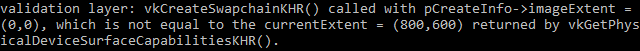
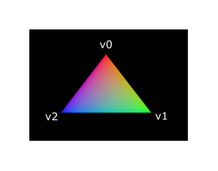
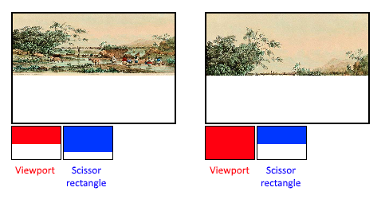

= Vulkan Triangle

== volk initialize

To use volk, you have to include volk.h instead of vulkan/vulkan.h; this is necessary to use function definitions from volk.
If some files in your application include vulkan/vulkan.h and don't include volk.h, this can result in symbol conflicts; consider defining VK_NO_PROTOTYPES when compiling code that uses Vulkan to make sure this doesn't happen. It's also important to make sure that vulkan-1 is not linked into the application, as this results in symbol name conflicts as well.
To initialize volk, call this function first:

[source,c++]
----
#define VOLK_IMPLEMENTATION
#include "volk.h"

void initVulkan() {
    if (volkInitialize() != VK_SUCCESS) {
        throw std::runtime_error("failed to initialize volk!");
    }
}
----

== General structure

In the previous chapter, you've created a Vulkan project with all the proper configurations and tested it with the sample code.
In this chapter, we're starting from scratch with the following code:

[source,c++]
----
#define VOLK_IMPLEMENTATION
#include "volk.h"
#include <SDL3/SDL.h>
#include <SDL3/SDL_vulkan.h>

#include <cstdlib>
#include <iostream>
#include <stdexcept>

class HelloTriangleApplication {
public:
    void run() {
        initVulkan();
        mainLoop();
        cleanup();
    }

private:
    void initWindow() {

    }

    void initVulkan() {

    }

    void mainLoop() {

    }

    void cleanup() {

    }
};

int main() {
    HelloTriangleApplication app;

    try {
        app.run();
    } catch (const std::exception &e) {
        std::cerr << e.what() << std::endl;
        return EXIT_FAILURE;
    }

    return EXIT_SUCCESS;
}
----

We first include the Vulkan header from the LunarG SDK, which provides the
functions, structures and enumerations. The `stdexcept` and `iostream` headers
are included for reporting and propagating errors. The `cstdlib`
header provides the `EXIT_SUCCESS` and `EXIT_FAILURE` macros.

The program itself is wrapped into a class where we'll store the Vulkan objects
as private class members and add functions to initiate each of them, which will
be called from the `initVulkan` function. Once everything has been prepared, we
enter the main loop to start rendering frames. We'll fill in the `mainLoop`
function to include a loop that iterates until the window is closed in a moment.
Once the window is closed and `mainLoop` returns, we'll make sure to deallocate
the resources we've used in the `cleanup` function.

If any kind of fatal error occurs during execution then we'll throw a
`std::runtime_error` exception with a descriptive message, which will propagate
back to the `main` function and be printed to the command prompt. To handle 
a variety of standard exception types as well, we catch the more general `std::exception`. One example of an error that we will deal with soon is finding 
out that a certain required extension is not supported.

Roughly every chapter that follows after this one will add one new function that
will be called from `initVulkan` and one or more new Vulkan objects to the
private class members that need to be freed at the end in `cleanup`.

== Integrating SDL

Vulkan works perfectly fine without creating a window if you want to use it for off-screen rendering.

[source,c++]
----
#include <SDL3/SDL.h>
#include <SDL3/SDL_main.h>
----

That way, SDL will include its own definitions and automatically load the Vulkan
C header with it. Add a `initWindow` function and add a call to it from the
`run` function before the other calls. We'll use that function to initialize
SDL and create a window.

[source,c++]
----
void run() {
    initWindow();
    initVulkan();
    mainLoop();
    cleanup();
}

private:
    void initWindow() {
    }
----

The very first call in `initWindow` should be `SDL_Init()`, which initializes the SDL library.

[source,c++]
----
SDL_Init(SDL_INIT_VIDEO);
----

All that's left now is creating the actual window. Add a `SDL_Window *window = nullptr`
private class member to store a reference to it and initialize the window with:

[source,c++]
----
window = SDL_CreateWindow("Vulkan", WIDTH, HEIGHT, SDL_WINDOW_VULKAN);
----

It's a good idea to use constants instead of hardcoded width and height numbers
because we'll be referring to these values a couple of times in the future. I've
added the following lines above the `HelloTriangleApplication` class definition:

[source,c++]
----
const uint32_t WIDTH  = 800;
const uint32_t HEIGHT = 600;
----

To keep the application running until either an error occurs or the window is
closed, we need to add an event loop to the `mainLoop` function as follows:

[source,c++]
----
void mainLoop() {
    bool running = true;
    while (running) {
        SDL_Event e;
        while (SDL_PollEvent(&e)) {
            if (e.type == SDL_EVENT_QUIT) {
                running = false;
            }
            if (e.type == SDL_EVENT_KEY_DOWN && e.key.key == SDLK_ESCAPE) {
                running = false;
            }
        }
    }
}
----

This code should be fairly self-explanatory. It loops and checks for events like
pressing the X button until the user has closed the window. This is also
the loop where we'll later call a function to render a single frame.

Once the window is closed, we need to clean up resources by destroying it and
terminating SDL itself. This will be our first `cleanup` code:

[source,c++]
----
void cleanup() {
    SDL_DestroyWindow(window);
    SDL_Quit();
}

----

Note that in this tutorial, this is the last time we'll have to do anything
in the cleanup() function. This code will never need to change again.

When you run the program now, you should see a window titled `Vulkan` show up
until the application is terminated by closing the window.

link:/00_base_code.cpp[00_base_code]

== Creating an instance

The very first thing you need to do is initialize the Vulkan library by creating
an *instance*. The instance is the connection between your application and the
Vulkan library, and creating it involves specifying some details about your
application to the driver.

Start by adding a `volkLoadInstance` function and invoking it in the `initVulkan` function.

[source,c++]
----
void initVulkan() {
    volkInitialize();

    volkLoadInstance(instance);
}
----

Additionally add a data member to hold the handle to the instance:

[source,c++]
----
private:
VkInstance instance;
----

Now, to create an instance, we'll first have to fill in a struct with some
information about our application. This data is technically optional, but it may
provide some useful information to the driver to optimize our specific
 application, (e.g., because it uses a well-known graphics engine with
certain special behavior). This struct is called `VkApplicationInfo`:

[source,c++]
----
VkApplicationInfo appInfo{};
appInfo.sType = VK_STRUCTURE_TYPE_APPLICATION_INFO;
appInfo.pApplicationName = "Hello Triangle";
appInfo.applicationVersion = VK_MAKE_VERSION(1, 0, 0);
appInfo.pEngineName = "No Engine";
appInfo.engineVersion = VK_MAKE_VERSION(1, 0, 0);
appInfo.apiVersion = VK_API_VERSION_1_4;
----

As mentioned before, many structs in Vulkan require you to explicitly specify
the type in the `sType` member. This is also one of the many structs with a
`pNext` member that can point to extension information in the future. We're
using value initialization here to leave it as `nullptr`.

A lot of information in Vulkan is passed through structs instead of function
parameters, and we'll have to fill in one more struct to provide sufficient
information for creating an instance. This next struct is not optional and tells
the Vulkan driver which global extensions and validation layers we want to use.
Global here means that they apply to the entire program and not a specific
device, which will become clear in the next few chapters.

[source,c++]
----
VkInstanceCreateInfo createInfo{};
createInfo.sType = VK_STRUCTURE_TYPE_INSTANCE_CREATE_INFO;
createInfo.pApplicationInfo = &appInfo;
----

The first two parameters are straightforward. The next two layers specify the
desired global extensions. As mentioned in the overview chapter, Vulkan is a
platform agnostic API, which means that you need an extension to interface with
the window system. SDL has a handy built-in function that returns the
extension(s) it needs to do that which we can pass to the struct:

[source,c++]
----
uint32_t     sdlExtensionCount = 0;
const char *const *sdlExtensions;
sdlExtensions = SDL_Vulkan_GetInstanceExtensions(&sdlExtensionCount);

createInfo.enabledExtensionCount   = sdlExtensionCount;
createInfo.ppEnabledExtensionNames = sdlExtensions;
----

The last two members of the struct determine the global validation layers to
enable. We'll talk about these more in-depth in the next chapter, so just leave
these empty for now.

[source,c++]
----
createInfo.enabledLayerCount = 0;
----

We've now specified everything Vulkan needs to create an instance and we can
finally issue the `vkCreateInstance` call:

[source,c++]
----
VkResult result = vkCreateInstance(&createInfo, nullptr, &instance);
----

As you'll see, the general pattern that object creation function parameters in
Vulkan follow is:

* Pointer to struct with creation info
* Pointer to custom allocator callbacks, always `nullptr` in this tutorial
* Pointer to the variable that stores the handle to the new object

If everything went well then the handle to the instance was stored in the
`VkInstance` class member. Nearly all Vulkan functions return a value of type
`VkResult` that is either `VK_SUCCESS` or an error code. To check if the
instance was created successfully, we don't need to store the result and can
just use a check for the success value instead:

[source,c++]
----
if (vkCreateInstance(&createInfo, nullptr, &instance) != VK_SUCCESS) {
    throw std::runtime_error("failed to create instance!");
}
----

Now run the program to make sure that the instance is created successfully.

== Cleaning up

The `VkInstance` should be only destroyed right before the program exits. It can
be destroyed in `cleanup` with the `vkDestroyInstance` function:

[,c++]
----
void cleanup() {
    vkDestroyInstance(instance, nullptr);
    SDL_DestroyWindow(window);
    SDL_Quit();
}
----

The parameters for the `vkDestroyInstance` function are straightforward. As
mentioned in the previous chapter, the allocation and deallocation functions
in Vulkan have an optional allocator callback that we'll ignore by passing
`nullptr` to it. All of the other Vulkan resources that we'll create in the
following chapters should be cleaned up before the instance is destroyed.

Before continuing with the more complex steps after instance creation, it's time
to evaluate our debugging options by checking out validation layers.

link:/01_instance_creation.cpp[01_instance_creation]

== What are validation layers

The Vulkan API is designed around the idea of minimal driver overhead and one of
the manifestations of that goal is that there is very limited error checking in
the API by default. Even mistakes as simple as setting enumerations to incorrect
values or passing null pointers to required parameters are generally not
explicitly handled and will simply result in crashes or undefined behavior.
Because Vulkan requires you to be very explicit about everything you're doing,
it's easy to make many small mistakes like using a new GPU feature and
forgetting to request it at logical device creation time.

However, that doesn't mean that these checks can't be added to the API. Vulkan
introduces an elegant system for this known as *validation layers*. Validation
layers are optional components that hook into Vulkan function calls to apply
additional operations. Common operations in validation layers are:

* Checking the values of parameters against the specification to detect misuse
* Tracking creation and destruction of objects to find resource leaks
* Checking thread safety by tracking the threads that calls originate from
* Logging every call and its parameters to the standard output
* Tracing Vulkan calls for profiling and replaying

Here's an example of what the implementation of a function in a diagnostics
validation layer could look like:

[source,c++]
----
VkResult vkCreateInstance(
    const VkInstanceCreateInfo* pCreateInfo,
    const VkAllocationCallbacks* pAllocator,
    VkInstance* instance) {

    if (pCreateInfo == nullptr || instance == nullptr) {
        log("Null pointer passed to required parameter!");
        return VK_ERROR_INITIALIZATION_FAILED;
    }

    return real_vkCreateInstance(pCreateInfo, pAllocator, instance);
}
----

These validation layers can be freely stacked to include all the debugging
functionality that you're interested in. You can simply enable validation layers
for debug builds and completely disable them for release builds, which gives you
the best of both worlds!

Vulkan does not come with any validation layers built-in, but the LunarG Vulkan
SDK provides a nice set of layers that check for common errors. They're also
completely https://github.com/KhronosGroup/Vulkan-ValidationLayers[open source],
so you can check which kind of mistakes they check for and contribute. Using the
validation layers is the best way to avoid your application breaking on
different drivers by accidentally relying on undefined behavior.

Validation layers can only be used if they have been installed onto the system.
For example, the LunarG validation layers are only available on PCs with the
Vulkan SDK installed.

There were formerly two different types of validation layers in Vulkan: instance
and device specific. The idea was that instance layers would only check
calls related to global Vulkan objects like instances, and device specific layers
would only check calls related to a specific GPU. Device specific layers have now been
deprecated, which means that instance validation layers apply to all Vulkan
calls. The specification document still recommends that you enable validation
layers at device level as well for compatibility, which is required by some
implementations. We'll simply specify the same layers as the instance at logical
device level, which we'll see later on.

== Using validation layers

In this section we'll see how to enable the standard diagnostics layers provided
by the Vulkan SDK. Just like extensions, validation layers need to be enabled by
specifying their name. All of the useful standard validation is bundled into a layer included in the SDK that is known as `VK_LAYER_KHRONOS_validation`.

Let's first add two configuration variables to the program to specify the layers
to enable and whether to enable them or not. I've chosen to base that value on
whether the program is being compiled in debug mode or not. The `NDEBUG` macro
is part of the C++ standard and means "not debug".

[source,c++]
----
const uint32_t WIDTH  = 800;
const uint32_t HEIGHT = 600;

const std::vector<const char*> validationLayers = {
    "VK_LAYER_KHRONOS_validation"
};

#ifdef NDEBUG
    const bool enableValidationLayers = false;
#else
    const bool enableValidationLayers = true;
#endif
----

We'll add a new function `checkValidationLayerSupport` that checks if all of
the requested layers are available. First list all of the available layers
using the `vkEnumerateInstanceLayerProperties` function. Its usage is identical
to that of `vkEnumerateInstanceExtensionProperties` which was discussed in the
instance creation chapter.

[source,c++]
----
bool checkValidationLayerSupport() {
    uint32_t layerCount;
    vkEnumerateInstanceLayerProperties(&layerCount, nullptr);

    std::vector<VkLayerProperties> availableLayers(layerCount);
    vkEnumerateInstanceLayerProperties(&layerCount, availableLayers.data());

    return false;
}
----

Next, check if all of the layers in `validationLayers` exist in the
`availableLayers` list. You may need to include `<cstring>` for `strcmp`.

[source,c++]
----
for (const char* layerName : validationLayers) {
    bool layerFound = false;

    for (const auto& layerProperties : availableLayers) {
        if (strcmp(layerName, layerProperties.layerName) == 0) {
            layerFound = true;
            break;
        }
    }

    if (!layerFound) {
        return false;
    }
}

return true;
----

Now run the program in debug mode and ensure that the error does not occur. If
it does, then have a look at the FAQ.

Finally, modify the `VkInstanceCreateInfo` struct instantiation to include the
validation layer names if they are enabled:

[source,c++]
----
if (enableValidationLayers) {
    createInfo.enabledLayerCount = static_cast<uint32_t>(validationLayers.size());
    createInfo.ppEnabledLayerNames = validationLayers.data();
} else {
    createInfo.enabledLayerCount = 0;
}
----

If the check was successful then `vkCreateInstance` should not ever return a
`VK_ERROR_LAYER_NOT_PRESENT` error, but you should run the program to make sure.

== Message callback

The validation layers will print debug messages to the standard output by default, but we can also handle them ourselves by providing an explicit callback in our program. This will also allow you to decide which kind of messages you would like to see, because not all are necessarily (fatal) errors. If you don't want to do that right now then you may skip to the last section in this chapter.

To set up a callback in the program to handle messages and the associated details, we have to set up a debug messenger with a callback using the `VK_EXT_debug_utils` extension.

We'll first create a `getRequiredExtensions` function that will return the
required list of extensions based on whether validation layers are enabled or
not:

[source,c++]
----
std::vector<const char *> getRequiredExtensions() {
    uint32_t     sdlExtensionCount = 0;
    const char *const *sdlExtensions;
    sdlExtensions = SDL_Vulkan_GetInstanceExtensions(&sdlExtensionCount);

    std::vector<const char *> extensions(sdlExtensions, sdlExtensions + sdlExtensionCount);

    if (enableValidationLayers) {
        extensions.push_back(VK_EXT_DEBUG_UTILS_EXTENSION_NAME);
    }

    return extensions;
}
----

The extensions specified by SDL are always required, but the debug messenger
extension is conditionally added. Note that I've used the
`VK_EXT_DEBUG_UTILS_EXTENSION_NAME` macro here which is equal to the literal
string "VK_EXT_debug_utils". Using this macro lets you avoid typos.

We can now use this function in `createInstance`:

[source,c++]
----
auto extensions = getRequiredExtensions();
createInfo.enabledExtensionCount = static_cast<uint32_t>(extensions.size());
createInfo.ppEnabledExtensionNames = extensions.data();
----

Run the program to make sure you don't receive a
`VK_ERROR_EXTENSION_NOT_PRESENT` error. We don't really need to check for the
existence of this extension, because it should be implied by the availability of
the validation layers.

Now let's see what a debug callback function looks like. Add a new static member
function called `debugCallback` with the `PFN_vkDebugUtilsMessengerCallbackEXT`
prototype. The `VKAPI_ATTR` and `VKAPI_CALL` ensure that the function has the
right signature for Vulkan to call it.

[source,c++]
----
static VKAPI_ATTR VkBool32 VKAPI_CALL debugCallback(
    VkDebugUtilsMessageSeverityFlagBitsEXT messageSeverity,
    VkDebugUtilsMessageTypeFlagsEXT messageType,
    const VkDebugUtilsMessengerCallbackDataEXT* pCallbackData,
    void* pUserData) {

    std::cerr << "validation layer: " << pCallbackData->pMessage << std::endl;

    return VK_FALSE;
}
----

The first parameter specifies the severity of the message, which is one of the following flags:

* `VK_DEBUG_UTILS_MESSAGE_SEVERITY_VERBOSE_BIT_EXT`: Diagnostic message
* `VK_DEBUG_UTILS_MESSAGE_SEVERITY_INFO_BIT_EXT`: Informational message like the creation of a resource
* `VK_DEBUG_UTILS_MESSAGE_SEVERITY_WARNING_BIT_EXT`: Message about behavior that is not necessarily an error, but very likely a bug in your application
* `VK_DEBUG_UTILS_MESSAGE_SEVERITY_ERROR_BIT_EXT`: Message about behavior that is invalid and may cause crashes

The values of this enumeration are set up in such a way that you can use a comparison operation to check if a message is equal or worse compared to some level of severity, for example:

[source,c++]
----
if (messageSeverity >= VK_DEBUG_UTILS_MESSAGE_SEVERITY_WARNING_BIT_EXT) {
    // Message is important enough to show
}
----

The `messageType` parameter can have the following values:

* `VK_DEBUG_UTILS_MESSAGE_TYPE_GENERAL_BIT_EXT`: Some event has happened that is unrelated to the specification or performance
* `VK_DEBUG_UTILS_MESSAGE_TYPE_VALIDATION_BIT_EXT`: Something has happened that violates the specification or indicates a possible mistake
* `VK_DEBUG_UTILS_MESSAGE_TYPE_PERFORMANCE_BIT_EXT`: Potential non-optimal use of Vulkan

The `pCallbackData` parameter refers to a `VkDebugUtilsMessengerCallbackDataEXT` struct containing the details of the message itself, with the most important members being:

* `pMessage`: The debug message as a null-terminated string
* `pObjects`: Array of Vulkan object handles related to the message
* `objectCount`: Number of objects in array

Finally, the `pUserData` parameter contains a pointer that was specified during the setup of the callback and allows you to pass your own data to it.

The callback returns a boolean that indicates if the Vulkan call that triggered
the validation layer message should be aborted. If the callback returns true,
then the call is aborted with the `VK_ERROR_VALIDATION_FAILED_EXT` error. This
is normally only used to test the validation layers themselves, so you should
always return `VK_FALSE`.

All that remains now is telling Vulkan about the callback function. Perhaps
somewhat surprisingly, even the debug callback in Vulkan is managed with a
handle that needs to be explicitly created and destroyed. Such a callback is part of a *debug messenger* and you can have as many of them as you want. Add a class member for
this handle right under `instance`:

[source,c++]
----
VkDebugUtilsMessengerEXT debugMessenger;
----

We'll need to fill in a structure with details about the messenger and its callback:

[source,c++]
----
VkDebugUtilsMessengerCreateInfoEXT createInfo{};
createInfo.sType = VK_STRUCTURE_TYPE_DEBUG_UTILS_MESSENGER_CREATE_INFO_EXT;
createInfo.messageSeverity = VK_DEBUG_UTILS_MESSAGE_SEVERITY_VERBOSE_BIT_EXT | VK_DEBUG_UTILS_MESSAGE_SEVERITY_WARNING_BIT_EXT | VK_DEBUG_UTILS_MESSAGE_SEVERITY_ERROR_BIT_EXT;
createInfo.messageType = VK_DEBUG_UTILS_MESSAGE_TYPE_GENERAL_BIT_EXT | VK_DEBUG_UTILS_MESSAGE_TYPE_VALIDATION_BIT_EXT | VK_DEBUG_UTILS_MESSAGE_TYPE_PERFORMANCE_BIT_EXT;
createInfo.pfnUserCallback = debugCallback;
createInfo.pUserData = nullptr; // Optional
----

The `messageSeverity` field allows you to specify all the types of severities you would like your callback to be called for. I've specified all types except for `VK_DEBUG_UTILS_MESSAGE_SEVERITY_INFO_BIT_EXT` here to receive notifications about possible problems while leaving out verbose general debug info.

Similarly the `messageType` field lets you filter which types of messages your callback is notified about. I've simply enabled all types here. You can always disable some if they're not useful to you.

Finally, the `pfnUserCallback` field specifies the pointer to the callback function. You can optionally pass a pointer to the `pUserData` field which will be passed along to the callback function via the `pUserData` parameter. You could use this to pass a pointer to the `HelloTriangleApplication` class, for example.

Note that there are many more ways to configure validation layer messages and debug callbacks, but this is a good setup to get started with for this tutorial. See the https://www.khronos.org/registry/vulkan/specs/1.3-extensions/html/chap50.html#VK_EXT_debug_utils[extension specification] for more info about the possibilities.

Make sure that this function is either a static class function or a function
outside the class. We can then call it in the `cleanup` function:

[source,c++]
----
void cleanup() {
    if (enableValidationLayers) {
        DestroyDebugUtilsMessengerEXT(instance, debugMessenger, nullptr);
    }
    vkDestroyInstance(instance, nullptr);
    SDL_DestroyWindow(window);
    SDL_Quit();
}
----

== Debugging instance creation and destruction

Although we've now added debugging with validation layers to the program we're not covering everything quite yet. The `vkCreateDebugUtilsMessengerEXT` call requires a valid instance to have been created and `vkDestroyDebugUtilsMessengerEXT` must be called before the instance is destroyed. This currently leaves us unable to debug any issues in the `vkCreateInstance` and `vkDestroyInstance` calls.

However, if you closely read the https://github.com/KhronosGroup/Vulkan-Docs/blob/main/appendices/VK_EXT_debug_utils.adoc#examples[extension documentation], you'll see that there is a way to create a separate debug utils messenger specifically for those two function calls. It requires you to simply pass a pointer to a `VkDebugUtilsMessengerCreateInfoEXT` struct in the `pNext` extension field of `VkInstanceCreateInfo`. First extract population of the messenger create info into a separate function:

[source,c++]
----
void populateDebugMessengerCreateInfo(VkDebugUtilsMessengerCreateInfoEXT& createInfo) {
    createInfo = {};
    createInfo.sType = VK_STRUCTURE_TYPE_DEBUG_UTILS_MESSENGER_CREATE_INFO_EXT;
    createInfo.messageSeverity = VK_DEBUG_UTILS_MESSAGE_SEVERITY_VERBOSE_BIT_EXT | VK_DEBUG_UTILS_MESSAGE_SEVERITY_WARNING_BIT_EXT | VK_DEBUG_UTILS_MESSAGE_SEVERITY_ERROR_BIT_EXT;
    createInfo.messageType = VK_DEBUG_UTILS_MESSAGE_TYPE_GENERAL_BIT_EXT | VK_DEBUG_UTILS_MESSAGE_TYPE_VALIDATION_BIT_EXT | VK_DEBUG_UTILS_MESSAGE_TYPE_PERFORMANCE_BIT_EXT;
    createInfo.pfnUserCallback = debugCallback;
}

...

if (!enableValidationLayers) return;

VkDebugUtilsMessengerCreateInfoEXT createInfo;
populateDebugMessengerCreateInfo(createInfo);

if (CreateDebugUtilsMessengerEXT(instance, &createInfo, nullptr, &debugMessenger) != VK_SUCCESS) {
    throw std::runtime_error("failed to set up debug messenger!");
}
----

We can now re-use this in the `initVulkan` function:

[source,c++]
----
void initVulkan() {
    ...

    VkInstanceCreateInfo createInfo{};
    createInfo.sType = VK_STRUCTURE_TYPE_INSTANCE_CREATE_INFO;
    createInfo.pApplicationInfo = &appInfo;

    ...

    VkDebugUtilsMessengerCreateInfoEXT debugCreateInfo{};
    if (enableValidationLayers) {
        createInfo.enabledLayerCount = static_cast<uint32_t>(validationLayers.size());
        createInfo.ppEnabledLayerNames = validationLayers.data();

        populateDebugMessengerCreateInfo(debugCreateInfo);
        createInfo.pNext = (VkDebugUtilsMessengerCreateInfoEXT*) &debugCreateInfo;
    } else {
        createInfo.enabledLayerCount = 0;

        createInfo.pNext = nullptr;
    }

    if (vkCreateInstance(&createInfo, nullptr, &instance) != VK_SUCCESS) {
        throw std::runtime_error("failed to create instance!");
    }
}
----

The `debugCreateInfo` variable is placed outside the if statement to ensure that it is not destroyed before the `vkCreateInstance` call. By creating an additional debug messenger this way it will automatically be used during `vkCreateInstance` and `vkDestroyInstance` and cleaned up after that.

== Configuration

There are a lot more settings for the behavior of validation layers than just
the flags specified in the `VkDebugUtilsMessengerCreateInfoEXT` struct. Browse
to the Vulkan SDK and go to the `Config` directory. There you will find a
`vk_layer_settings.txt` file that explains how to configure the layers.

To configure the layer settings for your own application, copy the file to the
`Debug` and `Release` directories of your project and follow the instructions to
set the desired behavior. However, for the remainder of this tutorial I'll
assume that you're using the default settings.

Throughout this tutorial I'll be making a couple of intentional mistakes to show
you how helpful the validation layers are with catching them and to teach you
how important it is to know exactly what you're doing with Vulkan. Now it's time
to look at Vulkan devices in the system.

link:/02_validation_layers.cpp[02_validation_layers]

== Selecting a physical device

After initializing the Vulkan library through a VkInstance we need to look for
and select a graphics card in the system that supports the features we need. In
fact we can select any number of graphics cards and use them simultaneously, but
in this tutorial we'll stick to the first graphics card that suits our needs.

The graphics card that we'll end up selecting will be stored in a
VkPhysicalDevice handle that is added as a new class member. This object will be
implicitly destroyed when the VkInstance is destroyed, so we won't need to do
anything new in the `cleanup` function.

[source,c++]
----
VkPhysicalDevice physicalDevice = VK_NULL_HANDLE;
----

Listing the graphics cards is very similar to listing extensions and starts with
querying just the number.
If there are 0 devices with Vulkan support then there is no point going further.
Otherwise we can now allocate an array to hold all of the VkPhysicalDevice handles.

[source,c++]
----
uint32_t deviceCount = 0;
vkEnumeratePhysicalDevices(instance, &deviceCount, nullptr);

if (deviceCount == 0) {
    throw std::runtime_error("failed to find GPUs with Vulkan support!");
}

std::vector<VkPhysicalDevice> devices(deviceCount);
vkEnumeratePhysicalDevices(instance, &deviceCount, devices.data());
----

And we'll check if any of the physical devices meet the requirements that we'll
add to that function.

[source,c++]
----
for (const auto& device : devices) {
    if (isDeviceSuitable(device)) {
        physicalDevice = device;
        break;
    }
}

if (physicalDevice == VK_NULL_HANDLE) {
    throw std::runtime_error("failed to find a suitable GPU!");
}
----

Now we need to evaluate each of them and check if they are suitable for the
operations we want to perform, because not all graphics cards are created equal.
For that we'll introduce a new function:

[source,c++]
----
bool isDeviceSuitable(VkPhysicalDevice device) {
    return true;
}
----

== Queue families

It has been briefly touched upon before that almost every operation in Vulkan,
anything from drawing to uploading textures, requires commands to be submitted
to a queue. There are different types of queues that originate from different
*queue families* and each family of queues allows only a subset of commands. For
example, there could be a queue family that only allows processing of compute
commands or one that only allows memory transfer related commands.

We need to check which queue families are supported by the device and which one
of these supports the commands that we want to use. For that purpose we'll add a
new function `findQueueFamilies` that looks for all the queue families we need.

Right now we are only going to look for a queue that supports graphics commands,
so the function could look like this:

[source,c++]
----
uint32_t findQueueFamilies(VkPhysicalDevice device) {
    // Logic to find graphics queue family
}
----

However, in one of the next chapters we're already going to look for yet another
queue, so it's better to prepare for that and bundle the indices into a struct:

But what if a queue family is not available? We could throw an exception in
`findQueueFamilies`, but this function is not really the right place to make
decisions about device suitability. For example, we may *prefer* devices with a
dedicated transfer queue family, but not require it. Therefore we need some way
of indicating whether a particular queue family was found.

It's not really possible to use a magic value to indicate the nonexistence of a
queue family, since any value of `uint32_t` could in theory be a valid queue
family index including `0`. Luckily C++17 introduced a data structure to distinguish between the case of a value existing or not.

The process of retrieving the list of queue families is exactly what you expect
and uses `vkGetPhysicalDeviceQueueFamilyProperties`:

[source,c++]
----
uint32_t queueFamilyCount = 0;
vkGetPhysicalDeviceQueueFamilyProperties(device, &queueFamilyCount, nullptr);

std::vector<VkQueueFamilyProperties> queueFamilies(queueFamilyCount);
vkGetPhysicalDeviceQueueFamilyProperties(device, &queueFamilyCount, queueFamilies.data());
----

We can now begin to actually implement `findQueueFamilies`:

[source,c++]
----
QueueFamilyIndices findQueueFamilies(VkPhysicalDevice device) {
    QueueFamilyIndices indices;

    ...

    return indices;
}
----

The VkQueueFamilyProperties struct contains some details about the queue family,
including the type of operations that are supported and the number of queues
that can be created based on that family. We need to find at least one queue
family that supports `VK_QUEUE_GRAPHICS_BIT`.

[source,c++]
----
int i = 0;
for (const auto& queueFamily : queueFamilies) {
    if (queueFamily.queueFlags & VK_QUEUE_GRAPHICS_BIT) {
        indices.graphicsFamily = i;
    }

    i++;
}
----

Now that we have this fancy queue family lookup function, we can use it as a
check in the `isDeviceSuitable` function to ensure that the device can process
the commands we want to use:

[source,c++]
----
bool isDeviceSuitable(VkPhysicalDevice device) {
    QueueFamilyIndices indices = findQueueFamilies(device);

    return indices.graphicsFamily.has_value();
}
----

To make this a little bit more convenient, we'll also add a generic check to the struct itself:

[source,c++]
----
struct QueueFamilyIndices {
    std::optional<uint32_t> graphicsFamily;

    bool isComplete() {
        return graphicsFamily.has_value();
    }
};

...

bool isDeviceSuitable(VkPhysicalDevice device) {
    QueueFamilyIndices indices = findQueueFamilies(device);

    return indices.isComplete();
}
----

We can now also use this for an early exit from `findQueueFamilies`:

[source,c++]
----
for (const auto& queueFamily : queueFamilies) {
    ...

    if (indices.isComplete()) {
        break;
    }

    i++;
}
----

Great, that's all we need for now to find the right physical device! The next
step is to create a logical device to interface with it.

link:/03_physical_device_selection.cpp[03_physical_device_selection]

== Introduction

After selecting a physical device to use we need to set up a *logical device* to
interface with it. The logical device creation process is similar to the
instance creation process and describes the features we want to use. We also
need to specify which queues to create now that we've queried which queue
families are available. You can even create multiple logical devices from the
same physical device if you have varying requirements.

Start by adding a new class member to store the logical device handle in.

[source,c++]
----
VkDevice device;
----

== Specifying the queues to be created

The creation of a logical device involves specifying a bunch of details in
structs again, of which the first one will be `VkDeviceQueueCreateInfo`. This
structure describes the number of queues we want for a single queue family.
Right now we're only interested in a queue with graphics capabilities.

[source,c++]
----
QueueFamilyIndices indices = findQueueFamilies(physicalDevice);

VkDeviceQueueCreateInfo queueCreateInfo{};
queueCreateInfo.sType = VK_STRUCTURE_TYPE_DEVICE_QUEUE_CREATE_INFO;
queueCreateInfo.queueFamilyIndex = indices.graphicsFamily.value();
queueCreateInfo.queueCount = 1;
----

The currently available drivers will only allow you to create a small number of
queues for each queue family and you don't really need more than one. That's
because you can create all of the command buffers on multiple threads and then
submit them all at once on the main thread with a single low-overhead call.

Vulkan lets you assign priorities to queues to influence the scheduling of
command buffer execution using floating point numbers between `0.0` and `1.0`.
This is required even if there is only a single queue:

[source,c++]
----
float queuePriority = 1.0f;
queueCreateInfo.pQueuePriorities = &queuePriority;
----

== Specifying used device features

The next information to specify is the set of device features that we'll be
using. These are the features that we queried support for with
`vkGetPhysicalDeviceFeatures` in the previous chapter, like geometry shaders.
Right now we don't need anything special, so we can simply define it and leave
everything to `VK_FALSE`. We'll come back to this structure once we're about to
start doing more interesting things with Vulkan.

[source,c++]
----
VkPhysicalDeviceFeatures deviceFeatures{};
----

== Creating the logical device

With the previous two structures in place, we can start filling in the main
`VkDeviceCreateInfo` structure.

[source,c++]
----
VkDeviceCreateInfo deviceCreateInfo{};
deviceCreateInfo.sType = VK_STRUCTURE_TYPE_DEVICE_CREATE_INFO;
----

First add pointers to the queue creation info and device features structs:

[source,c++]
----
deviceCreateInfo.pQueueCreateInfos    = &queueCreateInfo;
deviceCreateInfo.queueCreateInfoCount = 1;

deviceCreateInfo.pEnabledFeatures = &deviceFeatures;
----

The remainder of the information bears a resemblance to the
`VkInstanceCreateInfo` struct and requires you to specify extensions and
validation layers. The difference is that these are device specific this time.

An example of a device specific extension is `VK_KHR_swapchain`, which allows
you to present rendered images from that device to windows. It is possible that
there are Vulkan devices in the system that lack this ability, for example
because they only support compute operations. We will come back to this
extension in the swap chain chapter.

Previous implementations of Vulkan made a distinction between instance and device specific validation layers, but this is https://www.khronos.org/registry/vulkan/specs/1.3-extensions/html/chap40.html#extendingvulkan-layers-devicelayerdeprecation[no longer the case]. That means that the `enabledLayerCount` and `ppEnabledLayerNames` fields of `VkDeviceCreateInfo` are ignored by up-to-date implementations. However, it is still a good idea to set them anyway to be compatible with older implementations:

[source,c++]
----
devicecreateInfo.enabledExtensionCount = 0;

if (enableValidationLayers) {
    createInfo.enabledLayerCount = static_cast<uint32_t>(validationLayers.size());
    createInfo.ppEnabledLayerNames = validationLayers.data();
} else {
    createInfo.enabledLayerCount = 0;
}
----

We won't need any device specific extensions for now.

That's it, we're now ready to instantiate the logical device with a call to the
appropriately named `vkCreateDevice` function.

[source,c++]
----
if (vkCreateDevice(physicalDevice, &createInfo, nullptr, &device) != VK_SUCCESS) {
    throw std::runtime_error("failed to create logical device!");
}
----

The parameters are the physical device to interface with, the queue and usage
info we just specified, the optional allocation callbacks pointer and a pointer
to a variable to store the logical device handle in. Similarly to the instance
creation function, this call can return errors based on enabling non-existent
extensions or specifying the desired usage of unsupported features.

The device should be destroyed in `cleanup` with the `vkDestroyDevice` function:

[source,c++]
----
void cleanup() {
    vkDestroyDevice(device, nullptr);
    ...
}
----

Logical devices don't interact directly with instances, which is why it's not
included as a parameter.

== Retrieving queue handles

The queues are automatically created along with the logical device, but we don't
have a handle to interface with them yet. First add a class member to store a
handle to the graphics queue:

[source,c++]
----
VkQueue graphicsQueue;
----

Device queues are implicitly cleaned up when the device is destroyed, so we
don't need to do anything in `cleanup`.

We can use the `vkGetDeviceQueue` function to retrieve queue handles for each
queue family. The parameters are the logical device, queue family, queue index
and a pointer to the variable to store the queue handle in. Because we're only
creating a single queue from this family, we'll simply use index `0`.

[source,c++]
----
vkGetDeviceQueue(device, indices.graphicsFamily.value(), 0, &graphicsQueue);
----

With the logical device and queue handles we can now actually start using the
graphics card to do things! In the next few chapters we'll set up the resources
to present results to the window system.

link:/04_logical_device.cpp[04_logical_device]

Since Vulkan is a platform agnostic API, it can not interface directly with the
window system on its own. To establish the connection between Vulkan and the
window system to present results to the screen, we need to use the WSI (Window
System Integration) extensions. In this chapter we'll discuss the first one,
which is `VK_KHR_surface`. It exposes a `VkSurfaceKHR` object that represents an
abstract type of surface to present rendered images to. The surface in our
program will be backed by the window that we've already opened with SDL.

The `VK_KHR_surface` extension is an instance level extension and we've actually
already enabled it, because it's included in the list returned by
`SDL_Vulkan_GetInstanceExtensions`. The list also includes some other WSI
extensions that we'll use in the next couple of chapters.

The window surface needs to be created right after the instance creation,
because it can actually influence the physical device selection. The reason we
postponed this is because window surfaces are part of the larger topic of
render targets and presentation for which the explanation would have cluttered
the basic setup. It should also be noted that window surfaces are an entirely
optional component in Vulkan, if you just need off-screen rendering. Vulkan
allows you to do that without hacks like creating an invisible window
(necessary for OpenGL).

== Window surface creation

The SDL call takes simple parameters instead of a struct which makes the
implementation of the function very straightforward:

[source,c++]
----
if (!SDL_Vulkan_CreateSurface(window, instance, nullptr, &surface)) {
    throw std::runtime_error("failed to create window surface!");
}
----

The parameters are the `VkInstance`, SDL window pointer, custom allocators and
pointer to `VkSurfaceKHR` variable. It simply passes through the `VkResult` from
the relevant platform call. SDL doesn't offer a special function for destroying
a surface, but that can easily be done through the original API:

[source,c++]
----
void cleanup() {
        ...
        vkDestroySurfaceKHR(instance, surface, nullptr);
        vkDestroyInstance(instance, nullptr);
        ...
    }
----

Make sure that the surface is destroyed before the instance.

== Querying for presentation support

Although the Vulkan implementation may support window system integration, that
does not mean that every device in the system supports it. Therefore we need to
extend `isDeviceSuitable` to ensure that a device can present images to the
surface we created. Since the presentation is a queue-specific feature, the
problem is actually about finding a queue family that supports presenting to the
surface we created.

It's actually possible that the queue families supporting drawing commands and
the ones supporting presentation do not overlap. Therefore we have to take into
account that there could be a distinct presentation queue by modifying the
`QueueFamilyIndices` structure:

[source,c++]
----
struct QueueFamilyIndices {
    std::optional<uint32_t> graphicsFamily;
    std::optional<uint32_t> presentFamily;

    bool isComplete() {
        return graphicsFamily.has_value() && presentFamily.has_value();
    }
};
----

Next, we'll modify the `findQueueFamilies` function to look for a queue family
that has the capability of presenting to our window surface. The function to
check for that is `vkGetPhysicalDeviceSurfaceSupportKHR`, which takes the
physical device, queue family index and surface as parameters. Add a call to it
in the same loop as the `VK_QUEUE_GRAPHICS_BIT`:

[source,c++]
----
VkBool32 presentSupport = false;
vkGetPhysicalDeviceSurfaceSupportKHR(device, i, surface, &presentSupport);
----

Then simply check the value of the boolean and store the presentation family
queue index:

[source,c++]
----
if (presentSupport) {
    indices.presentFamily = i;
}
----

Note that it's very likely that these end up being the same queue family after
all, but throughout the program we will treat them as if they were separate
queues for a uniform approach. Nevertheless, you could add logic to explicitly
prefer a physical device that supports drawing and presentation in the same
queue for improved performance.

## Creating the presentation queue

The one thing that remains is modifying the logical device creation procedure to
create the presentation queue and retrieve the `VkQueue` handle. Add a member
variable for the handle:

[source,c++]
----
VkQueue presentQueue;
----

Next, we need to have multiple `VkDeviceQueueCreateInfo` structs to create a
queue from both families. An elegant way to do that is to create a set of all
unique queue families that are necessary for the required queues:

[source,c++]
----
#include <set>

...

QueueFamilyIndices indices = findQueueFamilies(physicalDevice);

std::vector<VkDeviceQueueCreateInfo> queueCreateInfos;
std::set<uint32_t> uniqueQueueFamilies = {indices.graphicsFamily.value(), indices.presentFamily.value()};

float queuePriority = 1.0f;
for (uint32_t queueFamily : uniqueQueueFamilies) {
    VkDeviceQueueCreateInfo queueCreateInfo{};
    queueCreateInfo.sType = VK_STRUCTURE_TYPE_DEVICE_QUEUE_CREATE_INFO;
    queueCreateInfo.queueFamilyIndex = queueFamily;
    queueCreateInfo.queueCount = 1;
    queueCreateInfo.pQueuePriorities = &queuePriority;
    queueCreateInfos.push_back(queueCreateInfo);
}
----

And modify `VkDeviceCreateInfo` to point to the vector:

[source,c++]
----

deviceCreateInfo.pQueueCreateInfos    = queueCreateInfos.data();
deviceCreateInfo.queueCreateInfoCount = static_cast<uint32_t>(queueCreateInfos.size());
----

If the queue families are the same, then we only need to pass its index once.
Call volkLoadDevice() to load the device-level Vulkan function pointers after creating the logical device.

[source,c++]
----
volkLoadDevice(VkDevice device);

vkGetDeviceQueue(device, indices.presentFamily.value(), 0, &presentQueue);
----

In case the queue families are the same, the two handles will most likely have
the same value now. In the next chapter we're going to look at swap chains and
how they give us the ability to present images to the surface.

link:/05_window_surface.cpp[05_window_suface]

Vulkan does not have the concept of a "default framebuffer", hence it requires an infrastructure that will own the buffers we will render to before we visualize them on the screen. This infrastructure is
known as the *swap chain* and must be created explicitly in Vulkan. The swap
chain is essentially a queue of images that are waiting to be presented to the
screen. Our application will acquire such an image to draw to it, and then
return it to the queue. How exactly the queue works and the conditions for
presenting an image from the queue depend on how the swap chain is set up, but
the general purpose of the swap chain is to synchronize the presentation of
images with the refresh rate of the screen.

== Checking for swap chain support

Not all graphics cards are capable of presenting images directly to a screen for
various reasons, for example because they are designed for servers and don't
have any display outputs. Secondly, since image presentation is heavily tied
into the window system and the surfaces associated with windows, it is not
actually part of the Vulkan core. You have to enable the `VK_KHR_swapchain`
device extension after querying for its support.

For that purpose we'll first extend the `isDeviceSuitable` function to check if
this extension is supported. We've previously seen how to list the extensions
that are supported by a `VkPhysicalDevice`, so doing that should be fairly
straightforward. Note that the Vulkan header file provides a nice macro
`VK_KHR_SWAPCHAIN_EXTENSION_NAME` that is defined as `VK_KHR_swapchain`. The
advantage of using this macro is that the compiler will catch misspellings.

First declare a list of required device extensions, similar to the list of
validation layers to enable.

[source,c++]
----
const std::vector<const char*> deviceExtensions = {
    VK_KHR_SWAPCHAIN_EXTENSION_NAME
};
----

Next, create a new function `checkDeviceExtensionSupport` that is called from
`isDeviceSuitable` as an additional check:

[source,c++]
----
bool isDeviceSuitable(VkPhysicalDevice device) {
    QueueFamilyIndices indices = findQueueFamilies(device);

    bool extensionsSupported = checkDeviceExtensionSupport(device);

    return indices.isComplete() && extensionsSupported;
}

bool checkDeviceExtensionSupport(VkPhysicalDevice device) {
    return true;
}
----

Modify the body of the function to enumerate the extensions and check if all of
the required extensions are amongst them.

[source,c++]
----
bool checkDeviceExtensionSupport(VkPhysicalDevice device) {
    uint32_t extensionCount;
    vkEnumerateDeviceExtensionProperties(device, nullptr, &extensionCount, nullptr);

    std::vector<VkExtensionProperties> availableExtensions(extensionCount);
    vkEnumerateDeviceExtensionProperties(device, nullptr, &extensionCount, availableExtensions.data());

    std::set<std::string> requiredExtensions(deviceExtensions.begin(), deviceExtensions.end());

    for (const auto& extension : availableExtensions) {
        requiredExtensions.erase(extension.extensionName);
    }

    return requiredExtensions.empty();
}
----

I've chosen to use a set of strings here to represent the unconfirmed required
extensions. That way we can easily tick them off while enumerating the sequence
of available extensions. Of course you can also use a nested loop like in
`checkValidationLayerSupport`. The performance difference is irrelevant. Now run
the code and verify that your graphics card is indeed capable of creating a
swap chain. It should be noted that the availability of a presentation queue,
as we checked in the previous chapter, implies that the swap chain extension
must be supported. However, it's still good to be explicit about things, and
the extension does have to be explicitly enabled.

== Enabling device extensions

Using a swapchain requires enabling the `VK_KHR_swapchain` extension first.
Enabling the extension just requires a small change to the logical device
creation structure:

[source,c++]
----
createInfo.enabledExtensionCount = static_cast<uint32_t>(deviceExtensions.size());
createInfo.ppEnabledExtensionNames = deviceExtensions.data();

...

deviceCreateInfo.enabledExtensionCount   = static_cast<uint32_t>(deviceExtensions.size());
deviceCreateInfo.ppEnabledExtensionNames = deviceExtensions.data();
----

Make sure to replace the existing line `createInfo.enabledExtensionCount = 0;` when you do so.

== Querying details of swap chain support

Just checking if a swap chain is available is not sufficient, because it may not
actually be compatible with our window surface. Creating a swap chain also
involves a lot more settings than instance and device creation, so we need to
query for some more details before we're able to proceed.

There are basically three kinds of properties we need to check:

* Basic surface capabilities (min/max number of images in swap chain, min/max
width and height of images)
* Surface formats (pixel format, color space)
* Available presentation modes

Similar to `findQueueFamilies`, we'll use a struct to pass these details around
once they've been queried. The three aforementioned types of properties come in
the form of the following structs and lists of structs:

[source,c++]
----
struct SwapChainSupportDetails {
    VkSurfaceCapabilitiesKHR capabilities;
    std::vector<VkSurfaceFormatKHR> formats;
    std::vector<VkPresentModeKHR> presentModes;
};
----

We'll now create a new function `querySwapChainSupport` that will populate this
struct.

[source,c++]
----
SwapChainSupportDetails querySwapChainSupport(VkPhysicalDevice device) {
    SwapChainSupportDetails details;

    return details;
}
----

This section covers how to query the structs that include this information. The
meaning of these structs and exactly which data they contain is discussed in the
next section.

Let's start with the basic surface capabilities. These properties are simple to
query and are returned into a single `VkSurfaceCapabilitiesKHR` struct.

[source,c++]
----
vkGetPhysicalDeviceSurfaceCapabilitiesKHR(device, surface, &details.capabilities);
----

This function takes the specified `VkPhysicalDevice` and `VkSurfaceKHR` window
surface into account when determining the supported capabilities. All of the
support querying functions have these two as first parameters because they are
the core components of the swap chain.

The next step is about querying the supported surface formats. Because this is a
list of structs, it follows the familiar ritual of 2 function calls:

[source,c++]
----
uint32_t formatCount;
vkGetPhysicalDeviceSurfaceFormatsKHR(device, surface, &formatCount, nullptr);

if (formatCount != 0) {
    details.formats.resize(formatCount);
    vkGetPhysicalDeviceSurfaceFormatsKHR(device, surface, &formatCount, details.formats.data());
}
----

Make sure that the vector is resized to hold all the available formats. And
finally, querying the supported presentation modes works exactly the same way
with `vkGetPhysicalDeviceSurfacePresentModesKHR`:

[source,c++]
----
uint32_t presentModeCount;
vkGetPhysicalDeviceSurfacePresentModesKHR(device, surface, &presentModeCount, nullptr);

if (presentModeCount != 0) {
    details.presentModes.resize(presentModeCount);
    vkGetPhysicalDeviceSurfacePresentModesKHR(device, surface, &presentModeCount, details.presentModes.data());
}
----

All of the details are in the struct now, so let's extend `isDeviceSuitable`
once more to utilize this function to verify that swap chain support is
adequate. Swap chain support is sufficient for this tutorial if there is at
least one supported image format and one supported presentation mode given the
window surface we have.

[source,c++]
----
bool swapChainAdequate = false;
if (extensionsSupported) {
    SwapChainSupportDetails swapChainSupport = querySwapChainSupport(device);
    swapChainAdequate = !swapChainSupport.formats.empty() && !swapChainSupport.presentModes.empty();
}
----

It is important that we only try to query for swap chain support after verifying
that the extension is available. The last line of the function changes to:

[source,c++]
----
return indices.isComplete() && extensionsSupported && swapChainAdequate;
----

== Choosing the right settings for the swap chain

If the `swapChainAdequate` conditions were met then the support is definitely
sufficient, but there may still be many different modes of varying optimality.
We'll now write a couple of functions to find the right settings for the best
possible swap chain. There are three types of settings to determine:

* Surface format (color depth)
* Presentation mode (conditions for "swapping" images to the screen)
* Swap extent (resolution of images in swap chain)

For each of these settings we'll have an ideal value in mind that we'll go with
if it's available and otherwise we'll create some logic to find the next best
thing.

=== Surface format

The function for this setting starts out like this. We'll later pass the
`formats` member of the `SwapChainSupportDetails` struct as argument.

[source,c++]
----
VkSurfaceFormatKHR chooseSwapSurfaceFormat(const std::vector<VkSurfaceFormatKHR>& availableFormats) {

}
----

Each `VkSurfaceFormatKHR` entry contains a `format` and a `colorSpace` member. The
`format` member specifies the color channels and types. For example,
`VK_FORMAT_B8G8R8A8_SRGB` means that we store the B, G, R and alpha channels in
that order with an 8 bit unsigned integer for a total of 32 bits per pixel. The
`colorSpace` member indicates if the SRGB color space is supported or not using
the `VK_COLOR_SPACE_SRGB_NONLINEAR_KHR` flag. Note that this flag used to be
called `VK_COLORSPACE_SRGB_NONLINEAR_KHR` in old versions of the specification.

For the color space we'll use SRGB if it is available, because it results in more accurate perceived colors. It is also pretty much the standard color space for images, like the textures we'll use later on.
Because of that we should also use an SRGB color format, of which one of the most common ones is `VK_FORMAT_B8G8R8A8_SRGB`.

Let's go through the list and see if the preferred combination is available:

[source,c++]
----
for (const auto& availableFormat : availableFormats) {
    if (availableFormat.format == VK_FORMAT_B8G8R8A8_SRGB && availableFormat.colorSpace == VK_COLOR_SPACE_SRGB_NONLINEAR_KHR) {
        return availableFormat;
    }
}
----

If that also fails then we could start ranking the available formats based on
how "good" they are, but in most cases it's okay to just settle with the first
format that is specified.

[source,c++]
----
VkSurfaceFormatKHR chooseSwapSurfaceFormat(const std::vector<VkSurfaceFormatKHR>& availableFormats) {
    for (const auto& availableFormat : availableFormats) {
        if (availableFormat.format == VK_FORMAT_B8G8R8A8_SRGB && availableFormat.colorSpace == VK_COLOR_SPACE_SRGB_NONLINEAR_KHR) {
            return availableFormat;
        }
    }

    return availableFormats[0];
}
----

== Presentation mode

The presentation mode is arguably the most important setting for the swap chain,
because it represents the actual conditions for showing images to the screen.
There are four possible modes available in Vulkan:

* `VK_PRESENT_MODE_IMMEDIATE_KHR`: Images submitted by your application are
transferred to the screen right away, which may result in tearing.
* `VK_PRESENT_MODE_FIFO_KHR`: The swap chain is a queue where the display takes
an image from the front of the queue when the display is refreshed and the
program inserts rendered images at the back of the queue. If the queue is full
then the program has to wait. This is most similar to vertical sync as found in
modern games. The moment that the display is refreshed is known as "vertical
blank".
* `VK_PRESENT_MODE_FIFO_RELAXED_KHR`: This mode only differs from the previous
one if the application is late and the queue was empty at the last vertical
blank. Instead of waiting for the next vertical blank, the image is transferred
right away when it finally arrives. This may result in visible tearing.
* `VK_PRESENT_MODE_MAILBOX_KHR`: This is another variation of the second mode.
Instead of blocking the application when the queue is full, the images that are
already queued are simply replaced with the newer ones. This mode can be used to
render frames as fast as possible while still avoiding tearing, resulting in fewer latency issues than standard vertical sync. This is commonly known as "triple buffering", although the existence of three buffers alone does not necessarily mean that the framerate is unlocked.

Only the `VK_PRESENT_MODE_FIFO_KHR` mode is guaranteed to be available, so we'll
again have to write a function that looks for the best mode that is available:

[source,c++]
----
VkPresentModeKHR chooseSwapPresentMode(const std::vector<VkPresentModeKHR>& availablePresentModes) {
    return VK_PRESENT_MODE_FIFO_KHR;
}
----

I personally think that `VK_PRESENT_MODE_MAILBOX_KHR` is a very nice trade-off if energy usage is not a concern. It allows us to avoid tearing while still maintaining a fairly low latency by rendering new images that are as up-to-date as possible right until the vertical blank. On mobile devices, where energy usage is more important, you will probably want to use `VK_PRESENT_MODE_FIFO_KHR` instead. Now, let's look through the list to see if `VK_PRESENT_MODE_MAILBOX_KHR` is available:

[source,c++]
----
VkPresentModeKHR chooseSwapPresentMode(const std::vector<VkPresentModeKHR>& availablePresentModes) {
    for (const auto& availablePresentMode : availablePresentModes) {
        if (availablePresentMode == VK_PRESENT_MODE_MAILBOX_KHR) {
            return availablePresentMode;
        }
    }

    return VK_PRESENT_MODE_FIFO_KHR;
}
----

== Swap extent

That leaves only one major property, for which we'll add one last function:

[source,c++]
----
VkExtent2D chooseSwapExtent(const VkSurfaceCapabilitiesKHR& capabilities) {

}
----

The swap extent is the resolution of the swap chain images and it's almost
always exactly equal to the resolution of the window that we're drawing to _in
pixels_ (more on that in a moment). The range of the possible resolutions is
defined in the `VkSurfaceCapabilitiesKHR` structure. Vulkan tells us to match
the resolution of the window by setting the width and height in the
`currentExtent` member. However, some window managers do allow us to differ here
and this is indicated by setting the width and height in `currentExtent` to a
special value: the maximum value of `uint32_t`. In that case we'll pick the
resolution that best matches the window within the `minImageExtent` and
`maxImageExtent` bounds. But we must specify the resolution in the correct unit.

SDL3 uses two units when measuring sizes: window coordinates and
https://wiki.libsdl.org/SDL3/README-highdpi[pixels].
For example, the resolution `{WIDTH, HEIGHT}` that we specified earlier when
creating the window is measured in screen coordinates. But Vulkan works with
pixels, so the swap chain extent must be specified in pixels as well.
Unfortunately, if you are using a high DPI display (like Apple's Retina
display), screen coordinates don't correspond to pixels. Instead, due to the
higher pixel density, the resolution of the window in pixel will be larger than
the resolution in screen coordinates. So if Vulkan doesn't fix the swap extent
for us, we can't just use the original `{WIDTH, HEIGHT}`. Instead, we must use
`SDL_GetWindowSizeInPixels` to query the resolution of the window in pixel before
matching it against the minimum and maximum image extent.

[source,c++]
----
#include <cstdint> // Necessary for uint32_t
#include <limits> // Necessary for std::numeric_limits
#include <algorithm> // Necessary for std::clamp

...

VkExtent2D chooseSwapExtent(const VkSurfaceCapabilitiesKHR& capabilities) {
    if (capabilities.currentExtent.width != std::numeric_limits<uint32_t>::max()) {
        return capabilities.currentExtent;
    } else {
        int width, height;
        SDL_GetWindowSizeInPixels(window, &width, &height);

        VkExtent2D actualExtent = {
            static_cast<uint32_t>(width),
            static_cast<uint32_t>(height)
        };

        actualExtent.width = std::clamp(actualExtent.width, capabilities.minImageExtent.width, capabilities.maxImageExtent.width);
        actualExtent.height = std::clamp(actualExtent.height, capabilities.minImageExtent.height, capabilities.maxImageExtent.height);

        return actualExtent;
    }
}
----

The `clamp` function is used here to bound the values of `width` and `height` between the allowed minimum and maximum extents that are supported by the implementation.

== Creating the swap chain

Now that we have all of these helper functions assisting us with the choices we
have to make at runtime, we finally have all the information that is needed to
create a working swap chain.

[source,c++]
----
SwapChainSupportDetails swapChainSupport = querySwapChainSupport(physicalDevice);

VkSurfaceFormatKHR surfaceFormat = chooseSwapSurfaceFormat(swapChainSupport.formats);
VkPresentModeKHR presentMode = chooseSwapPresentMode(swapChainSupport.presentModes);
VkExtent2D extent = chooseSwapExtent(swapChainSupport.capabilities);
----

Aside from these properties we also have to decide how many images we would like to have in the swap chain. The implementation specifies the minimum number that it requires to function:

[source,c++]
----
uint32_t imageCount = swapChainSupport.capabilities.minImageCount;
----

However, simply sticking to this minimum means that we may sometimes have to wait on the driver to complete internal operations before we can acquire another image to render to. Therefore it is recommended to request at least one more image than the minimum:

[source,c++]
----
uint32_t imageCount = swapChainSupport.capabilities.minImageCount + 1;
----

We should also make sure to not exceed the maximum number of images while doing this, where `0` is a special value that means that there is no maximum:

[source,c++]
----
if (swapChainSupport.capabilities.maxImageCount > 0 && imageCount > swapChainSupport.capabilities.maxImageCount) {
    imageCount = swapChainSupport.capabilities.maxImageCount;
}
----

As is tradition with Vulkan objects, creating the swap chain object requires
filling in a large structure. It starts out very familiarly:

[source,c++]
----
VkSwapchainCreateInfoKHR createInfo{};
chainCreateInfo.sType = VK_STRUCTURE_TYPE_SWAPCHAIN_CREATE_INFO_KHR;
chainCreateInfo.surface = surface;
----

After specifying which surface the swap chain should be tied to, the details of
the swap chain images are specified:

[source,c++]
----
chainCreateInfo.minImageCount = imageCount;
chainCreateInfo.imageFormat = surfaceFormat.format;
chainCreateInfo.imageColorSpace = surfaceFormat.colorSpace;
chainCreateInfo.imageExtent = extent;
chainCreateInfo.imageArrayLayers = 1;
chainCreateInfo.imageUsage = VK_IMAGE_USAGE_COLOR_ATTACHMENT_BIT;
----

The `imageArrayLayers` specifies the amount of layers each image consists of.
This is always `1` unless you are developing a stereoscopic 3D application. The
`imageUsage` bit field specifies what kind of operations we'll use the images in
the swap chain for. In this tutorial we're going to render directly to them,
which means that they're used as color attachment. It is also possible that
you'll render images to a separate image first to perform operations like
post-processing. In that case you may use a value like
`VK_IMAGE_USAGE_TRANSFER_DST_BIT` instead and use a memory operation to transfer
the rendered image to a swap chain image.

[source,c++]
----
indices = findQueueFamilies(physicalDevice);
uint32_t queueFamilyIndices[] = {indices.graphicsFamily.value(), indices.presentFamily.value()};

if (indices.graphicsFamily != indices.presentFamily) {
    chainCreateInfo.imageSharingMode = VK_SHARING_MODE_CONCURRENT;
    chainCreateInfo.queueFamilyIndexCount = 2;
    chainCreateInfo.pQueueFamilyIndices = queueFamilyIndices;
} else {
    chainCreateInfo.imageSharingMode = VK_SHARING_MODE_EXCLUSIVE;
    chainCreateInfo.queueFamilyIndexCount = 0; // Optional
    chainCreateInfo.pQueueFamilyIndices = nullptr; // Optional
}
----

Next, we need to specify how to handle swap chain images that will be used
across multiple queue families. That will be the case in our application if the
graphics queue family is different from the presentation queue. We'll be drawing
on the images in the swap chain from the graphics queue and then submitting them
on the presentation queue. There are two ways to handle images that are
accessed from multiple queues:

* `VK_SHARING_MODE_EXCLUSIVE`: An image is owned by one queue family at a time
and ownership must be explicitly transferred before using it in another queue
family. This option offers the best performance.
* `VK_SHARING_MODE_CONCURRENT`: Images can be used across multiple queue
families without explicit ownership transfers.

If the queue families differ, then we'll be using the concurrent mode in this
tutorial to avoid having to do the ownership chapters, because these involve
some concepts that are better explained at a later time. Concurrent mode
requires you to specify in advance between which queue families ownership will
be shared using the `queueFamilyIndexCount` and `pQueueFamilyIndices`
parameters. If the graphics queue family and presentation queue family are the
same, which will be the case on most hardware, then we should stick to exclusive
mode, because concurrent mode requires you to specify at least two distinct
queue families.

[source,c++]
----
chainCreateInfo.preTransform = swapChainSupport.capabilities.currentTransform;
----

We can specify that a certain transform should be applied to images in the swap
chain if it is supported (`supportedTransforms` in `capabilities`), like a 90
degree clockwise rotation or horizontal flip. To specify that you do not want
any transformation, simply specify the current transformation.

[source,c++]
----
chainCreateInfo.compositeAlpha = VK_COMPOSITE_ALPHA_OPAQUE_BIT_KHR;
----

The `compositeAlpha` field specifies if the alpha channel should be used for
blending with other windows in the window system. You'll almost always want to
simply ignore the alpha channel, hence `VK_COMPOSITE_ALPHA_OPAQUE_BIT_KHR`.

[source,c++]
----
chainCreateInfo.presentMode = presentMode;
chainCreateInfo.clipped = VK_TRUE;
----

The `presentMode` member speaks for itself. If the `clipped` member is set to
`VK_TRUE` then that means that we don't care about the color of pixels that are
obscured, for example because another window is in front of them. Unless you
really need to be able to read these pixels back and get predictable results,
you'll get the best performance by enabling clipping.

[source,c++]
----
chainCreateInfo.oldSwapchain = VK_NULL_HANDLE;
----

That leaves one last field, `oldSwapchain`. With Vulkan it's possible that your swap chain becomes invalid or unoptimized while your application is
running, for example because the window was resized. In that case the swap chain
actually needs to be recreated from scratch and a reference to the old one must
be specified in this field. This is a complex topic that we'll learn more about
in [a future chapter](!en/Drawing_a_triangle/Swap_chain_recreation). For now we'll
assume that we'll only ever create one swap chain.

Now add a class member to store the `VkSwapchainKHR` object:

[source,c++]
----
VkSwapchainKHR swapChain;
----

Creating the swap chain is now as simple as calling `vkCreateSwapchainKHR`:

[source,c++]
----
if (vkCreateSwapchainKHR(device, &createInfo, nullptr, &swapChain) != VK_SUCCESS) {
    throw std::runtime_error("failed to create swap chain!");
}
----

The parameters are the logical device, swap chain creation info, optional custom
allocators and a pointer to the variable to store the handle in. No surprises
there. It should be cleaned up using `vkDestroySwapchainKHR` before the device:

[source,c++]
----
void cleanup() {
    vkDestroySwapchainKHR(device, swapChain, nullptr);
    ...
}
----

Now run the application to ensure that the swap chain is created successfully! If at this point you get an access violation error in `vkCreateSwapchainKHR` or see a message like `Failed to find 'vkGetInstanceProcAddress' in layer SteamOverlayVulkanLayer.dll`, then see the FAQ entry about the Steam overlay layer.

Try removing the `createInfo.imageExtent = extent;` line with validation layers
enabled. You'll see that one of the validation layers immediately catches the
mistake and a helpful message is printed:

== Retrieving the swap chain images

The swap chain has been created now, so all that remains is retrieving the
handles of the `VkImage`s in it. We'll reference these during rendering
operations in later chapters. Add a class member to store the handles:

[source,c++]
----
std::vector<VkImage> swapChainImages;
----

The images were created by the implementation for the swap chain and they will
be automatically cleaned up once the swap chain has been destroyed, therefore we
don't need to add any cleanup code.

I'm adding the code to retrieve the handles to the end of the `createSwapChain`
function, right after the `vkCreateSwapchainKHR` call. Retrieving them is very
similar to the other times where we retrieved an array of objects from Vulkan. Remember that we only specified a minimum number of images in the swap chain, so the implementation is allowed to create a swap chain with more. That's why we'll first query the final number of images with `vkGetSwapchainImagesKHR`, then resize the container and finally call it again
to retrieve the handles.

[source,c++]
----
vkGetSwapchainImagesKHR(device, swapChain, &imageCount, nullptr);
swapChainImages.resize(imageCount);
vkGetSwapchainImagesKHR(device, swapChain, &imageCount, swapChainImages.data());
----

One last thing, store the format and extent we've chosen for the swap chain
images in member variables. We'll need them in future chapters.

[source,c++]
----
VkSwapchainKHR swapChain;
std::vector<VkImage> swapChainImages;
VkFormat swapChainImageFormat;
VkExtent2D swapChainExtent;

...

swapChainImageFormat = surfaceFormat.format;
swapChainExtent = extent;
----

We now have a set of images that can be drawn onto and can be presented to the
window. The next chapter will begin to cover how we can set up the images as
render targets and then we start looking into the actual graphics pipeline and
drawing commands!

link:/06_swap_chain_creation.cpp[06_swap_chain_creation]

To use any `VkImage`, including those in the swap chain, in the render pipeline
we have to create a `VkImageView` object. An image view is quite literally a
view into an image. It describes how to access the image and which part of the
image to access, for example if it should be treated as a 2D texture depth
texture without any mipmapping levels.

In this chapter we'll write a `createImageViews` function that creates a basic
image view for every image in the swap chain so that we can use them as color
targets later on.

First add a class member to store the image views in:

[source,c++]
----
std::vector<VkImageView> swapChainImageViews;
----

The first thing we need to do is resize the list to fit all of the image views
we'll be creating:

[source,c++]
----
swapChainImageViews.resize(swapChainImages.size());
----

Next, set up the loop that iterates over all of the swap chain images.

[source,c++]
----
for (size_t i = 0; i < swapChainImages.size(); i++) {

}
----

The parameters for image view creation are specified in a
`VkImageViewCreateInfo` structure. The first few parameters are straightforward.

[source,c++]
----
VkImageViewCreateInfo createInfo{};
createInfo.sType = VK_STRUCTURE_TYPE_IMAGE_VIEW_CREATE_INFO;
createInfo.image = swapChainImages[i];
----

The `viewType` and `format` fields specify how the image data should be
interpreted. The `viewType` parameter allows you to treat images as 1D textures,
2D textures, 3D textures and cube maps.

[source,c++]
----
createInfo.viewType = VK_IMAGE_VIEW_TYPE_2D;
createInfo.format = swapChainImageFormat;
----

The `components` field allows you to swizzle the color channels around. For
example, you can map all of the channels to the red channel for a monochrome
texture. You can also map constant values of `0` and `1` to a channel. In our
case we'll stick to the default mapping.

[source,c++]
----
createInfo.components.r = VK_COMPONENT_SWIZZLE_IDENTITY;
createInfo.components.g = VK_COMPONENT_SWIZZLE_IDENTITY;
createInfo.components.b = VK_COMPONENT_SWIZZLE_IDENTITY;
createInfo.components.a = VK_COMPONENT_SWIZZLE_IDENTITY;
----

The `subresourceRange` field describes what the image's purpose is and which
part of the image should be accessed. Our images will be used as color targets
without any mipmapping levels or multiple layers.

[source,c++]
----
createInfo.subresourceRange.aspectMask = VK_IMAGE_ASPECT_COLOR_BIT;
createInfo.subresourceRange.baseMipLevel = 0;
createInfo.subresourceRange.levelCount = 1;
createInfo.subresourceRange.baseArrayLayer = 0;
createInfo.subresourceRange.layerCount = 1;
----

If you were working on a stereographic 3D application, then you would create a
swap chain with multiple layers. You could then create multiple image views for
each image representing the views for the left and right eyes by accessing
different layers.

Creating the image view is now a matter of calling `vkCreateImageView`:

[source,c++]
----
if (vkCreateImageView(device, &createInfo, nullptr, &swapChainImageViews[i]) != VK_SUCCESS) {
    throw std::runtime_error("failed to create image views!");
}
----

Unlike images, the image views were explicitly created by us, so we need to add
a similar loop to destroy them again at the end of the program:

[source,c++]
----
void cleanup() {
    for (auto imageView : swapChainImageViews) {
        vkDestroyImageView(device, imageView, nullptr);
    }

    ...
}
----

An image view is sufficient to start using an image as a texture, but it's not
quite ready to be used as a render target just yet. That requires one more step
of indirection, known as a framebuffer. But first we'll have to set up the
graphics pipeline.

link:/07_image_views.cpp[07_image_views]

== Vertex shader

We can directly output normalized device coordinates by outputting them as clip
coordinates from the vertex shader with the last component set to `1`. That way
the division to transform clip coordinates to normalized device coordinates will
not change anything.

Normally these coordinates would be stored in a vertex buffer, but creating a
vertex buffer in Vulkan and filling it with data is not trivial. Therefore I've
decided to postpone that until after we've had the satisfaction of seeing a
triangle pop up on the screen. We're going to do something a little unorthodox
in the meanwhile: include the coordinates directly inside the vertex shader. The
code looks like this:

[source,slang]
----
static float2 positions[3] = float2,
    float2(0.5, 0.5),
    float2(-0.5, 0.5)
);

struct VertexOutput {
    float4 sv_position : SV_Position;
};

[shader("vertex")]
VertexOutput vertMain(uint vid : SV_VertexID) {
    VertexOutput output;
    output.sv_position = float4(positions[vid], 0.0, 1.0);
    return output;
}
----

The `vertMain` function is invoked for every vertex. The built-in `SV_VertexID`
annotated variable in the parameters contains the index of the current vertex.
This is usually an index into the vertex buffer, but in our case, it will be
an index into a hardcoded array of vertex data. The position of each vertex
is accessed from the constant array in the shader and combined with dummy
`z` and `w` components to produce a position in clip coordinates. The
built-in annotation `SV_Position` marks the output in the VertexOutput struct.
Something worth mentioning if you're familiar with other shading languages
like GLSL or HLSL, there are no instructions for bindings.  This is a feature
of Slang.  Slang is designed to automatically infer the bindings by the
order of declaration.  The struct for positions is a static to inform the
compiler that we don't need any bindings in our shader.
Studious observers will notice that we're calling our main function
vertMain instead of main, this is because Slang and SPIR-V both support
having multiple entry points in one file.  This is important when you're
dealing with pipelines which have more than just a single vert/frag shader
combo.  Ray-tracing for instance, for even simple demos would have four or
more shaders all small yet needing their own file which can become cumbersome.
Another major feature of Slang is the ability to create shader libraries
or modules; an exercise left to the reader is to explore more about this
feature rich shading language.

In this tutorial, we're going to demonstrate best practices by keeping the
shaders to a single file.  If you know GLSL, there's GLSL versions of the
shaders in the attachments folder which are direct translations.

== Fragment shader

The triangle formed by the positions from the vertex shader fills an
area on the screen with fragments. The fragment shader is invoked on these
fragments to produce a color and depth for the framebuffer (or framebuffers). A
simple fragment shader that outputs the color red for the entire triangle looks
like this:

[source,slang]
----
[shader("fragment")]
float4 fragMain() : SV_Target
{
    return float4(1.0, 0.0, 0.0, 1.0);
}
----

The `fragMain` entry point function is called for every fragment just like the
vertex shader `vertMain` function is called for every vertex. Colors in Slang
are 4-component vectors with the R, G, B and alpha channels within the [0, 1] range.
The `SV_Target` annotation on the return value marks it as a color written to a
framebuffer. It's actually optional here: Slang infers the render target from the
return value on its own, even when a shader writes to more than one framebuffer, so
`SV_Target` is only needed if you want to pin a particular output to a specific
framebuffer index explicitly. We keep it in these examples for clarity about what's
being written where. The color red is returned directly as `float4(1.0, 0.0, 0.0, 1.0)`.

== Per-vertex colors

Making the entire triangle red is not very interesting, wouldn't something like
the following look a lot nicer?

We have to make a couple of changes to both shaders to achieve this. First
off, we need to specify a distinct color for each of the three vertices. The
vertex shader should now include an array with colors just like it does for
positions:

[source,slang]
----
static float3 colors[3] = float3,
    float3(0.0, 1.0, 0.0),
    float3(0.0, 0.0, 1.0)
);
----

Now we just need to pass these per-vertex colors to the fragment shader so it
can output their interpolated values to the framebuffer. Add an output for color
to the vertex shader and write to it in the `vertMain` function:

[source,slang]
----
struct VertexOutput {
    float3 color;
    float4 sv_position : SV_Position;
};

[shader("vertex")]
VertexOutput vertMain(uint vid : SV_VertexID) {
    VertexOutput output;
    output.sv_position = float4(positions[vid], 0.0, 1.0);
    output.color = colors[vid];
    return output;
}
----

Next, we need to add a matching input in the fragment shader:

[source,slang]
----
[shader("fragment")]
float4 fragMain(VertexOutput inVert) : SV_Target
{
    float3 color = inVert.color;
    return float4(color, 1.0);
}
----

The input variable does not necessarily have to use the same name, however,
if they are in the same file, it really is convenient to not repeat ourselves.
But either way, they will be linked together using the indexes specified by
the `location` directives. The `fragMain` function has been modified to output
the color along with an alpha value. As shown in the image above, the values
for `fragColor` will be automatically  interpolated for the fragments between
 the three vertices, resulting in a smooth gradient.

== Loading a shader

Now that we have a way of producing SPIR-V shaders, it's time to load them into
our program to plug them into the graphics pipeline at some point. We'll first
write a simple helper function to load the binary data from the files.

[source,c++]
----
#include <fstream>

...

static std::vector<char> readFile(const std::string& filename) {
    std::ifstream file(filename, std::ios::ate | std::ios::binary);

    if (!file.is_open()) {
        throw std::runtime_error("failed to open file!");
    }
}
----

The `readFile` function will read all of the bytes from the specified file and
return them in a byte array managed by `std::vector`. We start by opening the
file with two flags:

* `ate`: Start reading at the end of the file
* `binary`: Read the file as binary file (avoid text transformations)

The advantage of starting to read at the end of the file is that we can use the
read position to determine the size of the file and allocate a buffer:

[source,c++]
----
size_t fileSize = (size_t) file.tellg();
std::vector<char> buffer(fileSize);
----

After that, we can seek back to the beginning of the file and read all of the
bytes at once:

[source,c++]
----
file.seekg(0);
file.read(buffer.data(), fileSize);
----

And finally close the file and return the bytes:

[source,c++]
----
file.close();

return buffer;
----

We'll now call this function from `createGraphicsPipeline` to load the bytecode
of the two shaders:

[source,c++]
----
auto           shaderCode   = readFile(SHADER_FILE_PATH);
----

Make sure that the shaders are loaded correctly by printing the size of the
buffers and checking if they match the actual file size in bytes. Note that the code doesn't need to be null terminated since it's binary code and we will later be explicit about its size.

== Creating shader modules

Before we can pass the code to the pipeline, we have to wrap it in a
`VkShaderModule` object. Let's create a helper function `createShaderModule` to
do that.

[source,c++]
----
VkShaderModule createShaderModule(const std::vector<char>& code) {

}
----

The function will take a buffer with the bytecode as parameter and create a
`VkShaderModule` from it.

Creating a shader module is simple, we only need to specify a pointer to the
buffer with the bytecode and the length of it. This information is specified in
a `VkShaderModuleCreateInfo` structure. The one catch is that the size of the
bytecode is specified in bytes, but the bytecode pointer is a `uint32_t` pointer
rather than a `char` pointer. Therefore we will need to cast the pointer with
`reinterpret_cast` as shown below. When you perform a cast like this, you also
need to ensure that the data satisfies the alignment requirements of `uint32_t`.
Lucky for us, the data is stored in an `std::vector` where the default allocator
already ensures that the data satisfies the worst case alignment requirements.

[source,c++]
----
VkShaderModuleCreateInfo createInfo{};
createInfo.sType = VK_STRUCTURE_TYPE_SHADER_MODULE_CREATE_INFO;
createInfo.codeSize = code.size();
createInfo.pCode = reinterpret_cast<const uint32_t*>(code.data());
----

The `VkShaderModule` can then be created with a call to `vkCreateShaderModule`:

[source,c++]
----
VkShaderModule shaderModule;
if (vkCreateShaderModule(device, &createInfo, nullptr, &shaderModule) != VK_SUCCESS) {
    throw std::runtime_error("failed to create shader module!");
}
----

The parameters are the same as those in previous object creation functions: the
logical device, pointer to create info structure, optional pointer to custom
allocators and handle output variable. The buffer with the code can be freed
immediately after creating the shader module. Don't forget to return the created
shader module:

[source,c++]
----
return shaderModule;
----

Shader modules are just a thin wrapper around the shader bytecode that we've previously loaded from a file and the functions defined in it. The compilation and linking of the SPIR-V bytecode to machine code for execution by the GPU doesn't happen until the graphics pipeline is created. That means that we're allowed to destroy the shader modules again as soon as pipeline creation is finished, which is why we'll make them local variables in the `createGraphicsPipeline` function instead of class members:

[source,c++]
----
auto           shaderCode   = readFile(SHADER_FILE_PATH);
VkShaderModule shaderModule = createShaderModule(shaderCode);
----

The cleanup should then happen at the end of the function by adding two calls to `vkDestroyShaderModule`. All of the remaining code in this chapter will be inserted before these lines.

[source,c++]
----
vkDestroyShaderModule(device, shaderModule, nullptr);
----

== Shader stage creation

To actually use the shaders we'll need to assign them to a specific pipeline stage through `VkPipelineShaderStageCreateInfo` structures as part of the actual pipeline creation process.

We'll start by filling in the structure for the vertex shader, again in the
`createGraphicsPipeline` function.

[source,c++]
----
VkPipelineShaderStageCreateInfo vertShaderStageInfo{};
vertShaderStageInfo.sType = VK_STRUCTURE_TYPE_PIPELINE_SHADER_STAGE_CREATE_INFO;
vertShaderStageInfo.stage = VK_SHADER_STAGE_VERTEX_BIT;
----

The first step, besides the obligatory `sType` member, is telling Vulkan in
which pipeline stage the shader is going to be used. There is an enum value for
each of the programmable stages described in the previous chapter.

[source,c++]
----
vertShaderStageInfo.module = shaderModule;
vertShaderStageInfo.pName  = "vertMain";
----

The next two members specify the shader module containing the code, and the
function to invoke, known as the *entrypoint*. That means that it's possible to combine multiple fragment
shaders into a single shader module and use different entry points to
differentiate between their behaviors. In this case we'll stick to the standard
`main`, however.

There is one more (optional) member, `pSpecializationInfo`, which we won't be
using here, but is worth discussing. It allows you to specify values for shader
constants. You can use a single shader module where its behavior can be
configured at pipeline creation by specifying different values for the constants
used in it. This is more efficient than configuring the shader using variables
at render time, because the compiler can do optimizations like eliminating `if`
statements that depend on these values. If you don't have any constants like
that, then you can set the member to `nullptr`, which our struct initialization
does automatically.

Modifying the structure to suit the fragment shader is easy:

[source,c++]
----
VkPipelineShaderStageCreateInfo fragShaderStageInfo{};
fragShaderStageInfo.sType  = VK_STRUCTURE_TYPE_PIPELINE_SHADER_STAGE_CREATE_INFO;
fragShaderStageInfo.stage  = VK_SHADER_STAGE_FRAGMENT_BIT;
fragShaderStageInfo.module = shaderModule;
fragShaderStageInfo.pName  = "fragMain";
----

Finish by defining an array that contains these two structs, which we'll later
use to reference them in the actual pipeline creation step.

[source,c++]
----
VkPipelineShaderStageCreateInfo shaderStages[] = {vertShaderStageInfo, fragShaderStageInfo};
----

That's all there is to describing the programmable stages of the pipeline. In
the next chapter we'll look at the fixed-function stages.

link:/08_shader_modules.cpp[08_shader_modules]
link:/08_shader_base.slang[08_shader_base]

The older graphics APIs provided default state for most of the stages of the
graphics pipeline. In Vulkan you have to be explicit about most pipeline states as
it'll be baked into an immutable pipeline state object. In this chapter we'll fill 
in all of the structures to configure these fixed-function operations.

== Dynamic state

While *most* of the pipeline state needs to be baked into the pipeline state, 
a limited amount of the state *can* actually be changed without recreating the 
pipeline at draw time. Examples are the size of the viewport, line width 
and blend constants. If you want to use dynamic state and keep these properties out, 
then you'll have to fill in a `VkPipelineDynamicStateCreateInfo` structure like this:

[source,c++]
----
std::vector<VkDynamicState> dynamicStates = {
    VK_DYNAMIC_STATE_VIEWPORT,
    VK_DYNAMIC_STATE_SCISSOR
};

VkPipelineDynamicStateCreateInfo dynamicState{};
dynamicState.sType = VK_STRUCTURE_TYPE_PIPELINE_DYNAMIC_STATE_CREATE_INFO;
dynamicState.dynamicStateCount = static_cast<uint32_t>(dynamicStates.size());
dynamicState.pDynamicStates = dynamicStates.data();
----

This will cause the configuration of these values to be ignored and you will be
able (and required) to specify the data at drawing time. This results in a more flexible
setup and is very common for things like viewport and scissor state, which would
result in a more complex setup when being baked into the pipeline state.

== Vertex input

The `VkPipelineVertexInputStateCreateInfo` structure describes the format of the
vertex data that will be passed to the vertex shader. It describes this in
roughly two ways:

* Bindings: spacing between data and whether the data is per-vertex or
per-instance see instancing
* Attribute descriptions: type of the attributes passed to the vertex shader,
which binding to load them from and at which offset

Because we're hard coding the vertex data directly in the vertex shader, we'll
fill in this structure to specify that there is no vertex data to load for now.
We'll get back to it in the vertex buffer chapter.

[source,c++]
----
VkPipelineVertexInputStateCreateInfo vertexInputInfo{};
vertexInputInfo.sType = VK_STRUCTURE_TYPE_PIPELINE_VERTEX_INPUT_STATE_CREATE_INFO;
vertexInputInfo.vertexBindingDescriptionCount = 0;
vertexInputInfo.pVertexBindingDescriptions = nullptr; // Optional
vertexInputInfo.vertexAttributeDescriptionCount = 0;
vertexInputInfo.pVertexAttributeDescriptions = nullptr; // Optional
----

The `pVertexBindingDescriptions` and `pVertexAttributeDescriptions` members
point to an array of structs that describe the aforementioned details for
loading vertex data. Add this structure to the `createGraphicsPipeline` function
right after the `shaderStages` array.

== Input assembly

The `VkPipelineInputAssemblyStateCreateInfo` struct describes two things: what
kind of geometry will be drawn from the vertices and if primitive restart should
be enabled. The former is specified in the `topology` member and can have values
like:

* `VK_PRIMITIVE_TOPOLOGY_POINT_LIST`: points from vertices
* `VK_PRIMITIVE_TOPOLOGY_LINE_LIST`: line from every 2 vertices without reuse
* `VK_PRIMITIVE_TOPOLOGY_LINE_STRIP`: the end vertex of every line is used as
start vertex for the next line
* `VK_PRIMITIVE_TOPOLOGY_TRIANGLE_LIST`: triangle from every 3 vertices without
reuse
* `VK_PRIMITIVE_TOPOLOGY_TRIANGLE_STRIP `: the second and third vertex of every
triangle are used as first two vertices of the next triangle

Normally, the vertices are loaded from the vertex buffer by index in sequential
order, but with an *element buffer* you can specify the indices to use yourself.
This allows you to perform optimizations like reusing vertices. If you set the
`primitiveRestartEnable`  member to `VK_TRUE`, then it's possible to break up
lines and triangles in the `_STRIP` topology modes by using a special index of
`0xFFFF` or `0xFFFFFFFF`.

We intend to draw triangles throughout this tutorial, so we'll stick to the
following data for the structure:

[source,c++]
----
VkPipelineInputAssemblyStateCreateInfo inputAssembly{};
inputAssembly.sType = VK_STRUCTURE_TYPE_PIPELINE_INPUT_ASSEMBLY_STATE_CREATE_INFO;
inputAssembly.topology = VK_PRIMITIVE_TOPOLOGY_TRIANGLE_LIST;
inputAssembly.primitiveRestartEnable = VK_FALSE;
----

== Viewports and scissors

A viewport basically describes the region of the framebuffer that the output
will be rendered to. This will almost always be `(0, 0)` to `(width, height)`
and in this tutorial that will also be the case.

[source,c++]
----
VkViewport viewport{};
viewport.x = 0.0f;
viewport.y = 0.0f;
viewport.width = (float) swapChainExtent.width;
viewport.height = (float) swapChainExtent.height;
viewport.minDepth = 0.0f;
viewport.maxDepth = 1.0f;
----

Remember that the size of the swap chain and its images may differ from the
`WIDTH` and `HEIGHT` of the window. The swap chain images will be used as
framebuffers later on, so we should stick to their size.

The `minDepth` and `maxDepth` values specify the range of depth values to use
for the framebuffer. These values must be within the `[0.0f, 1.0f]` range, but
`minDepth` may be higher than `maxDepth`. If you aren't doing anything special,
then you should stick to the standard values of `0.0f` and `1.0f`.

While viewports define the transformation from the image to the framebuffer,
scissor rectangles define in which regions pixels will actually be stored. Any
pixels outside the scissor rectangles will be discarded by the rasterizer. They
function like a filter rather than a transformation. The difference is
illustrated below. Note that the left scissor rectangle is just one of the many
possibilities that would result in that image, as long as it's larger than the
viewport.

So if we wanted to draw to the entire framebuffer, we would specify a scissor rectangle that covers it entirely:

[source,c++]
----
VkRect2D scissor{};
scissor.offset = {0, 0};
scissor.extent = swapChainExtent;
----

Viewport(s) and scissor rectangle(s) can either be specified as a static part of the pipeline or as a dynamic state set in the command buffer. While the former is more in line with the other states it's often convenient to make viewport and scissor state dynamic as it gives you a lot more flexibility. This is very common and all implementations can handle this dynamic state without a performance penalty.

When opting for dynamic viewport(s) and scissor rectangle(s) you need to enable the respective dynamic states for the pipeline:

[source,c++]
----
std::vector<VkDynamicState> dynamicStates = {
    VK_DYNAMIC_STATE_VIEWPORT,
    VK_DYNAMIC_STATE_SCISSOR
};

VkPipelineDynamicStateCreateInfo dynamicState{};
dynamicState.sType = VK_STRUCTURE_TYPE_PIPELINE_DYNAMIC_STATE_CREATE_INFO;
dynamicState.dynamicStateCount = static_cast<uint32_t>(dynamicStates.size());
dynamicState.pDynamicStates = dynamicStates.data();
----

And then you only need to specify their count at pipeline creation time:

[source,c++]
----
VkPipelineViewportStateCreateInfo viewportState{};
viewportState.sType = VK_STRUCTURE_TYPE_PIPELINE_VIEWPORT_STATE_CREATE_INFO;
viewportState.viewportCount = 1;
viewportState.scissorCount = 1;
----

The actual viewport(s) and scissor rectangle(s) will then later be set up at drawing time.

With dynamic state it's even possible to specify different viewports and or scissor rectangles within a single command buffer.

Without dynamic state, the viewport and scissor rectangle need to be set in the pipeline using the `VkPipelineViewportStateCreateInfo` struct. This makes the viewport and scissor rectangle for this pipeline immutable.
Any changes required to these values would require a new pipeline to be created with the new values.

[source,c++]
----
VkPipelineViewportStateCreateInfo viewportState{};
viewportState.sType = VK_STRUCTURE_TYPE_PIPELINE_VIEWPORT_STATE_CREATE_INFO;
viewportState.viewportCount = 1;
viewportState.pViewports = &viewport;
viewportState.scissorCount = 1;
viewportState.pScissors = &scissor;
----

Independent of how you set them, it's possible to use multiple viewports and scissor rectangles on some graphics cards, so the structure members reference an array of them. Using multiple requires enabling a GPU feature (see logical device creation).

== Rasterizer

The rasterizer takes the geometry that is shaped by the vertices from the vertex
shader and turns it into fragments to be colored by the fragment shader. It also
performs depth testing , face culling and the scissor
test, and it can be configured to output fragments that fill entire polygons or
just the edges (wireframe rendering). All this is configured using the
`VkPipelineRasterizationStateCreateInfo` structure.

[source,c++]
----
VkPipelineRasterizationStateCreateInfo rasterizer{};
rasterizer.sType = VK_STRUCTURE_TYPE_PIPELINE_RASTERIZATION_STATE_CREATE_INFO;
rasterizer.depthClampEnable = VK_FALSE;
----

If `depthClampEnable` is set to `VK_TRUE`, then fragments that are beyond the
near and far planes are clamped to them as opposed to discarding them. This is
useful in some special cases like shadow maps. Using this requires enabling a
GPU feature.

[source,c++]
----
rasterizer.rasterizerDiscardEnable = VK_FALSE;
----

If `rasterizerDiscardEnable` is set to `VK_TRUE`, then geometry never passes
through the rasterizer stage. This basically disables any output to the
framebuffer.

[source,c++]
----
rasterizer.polygonMode = VK_POLYGON_MODE_FILL;
----

The `polygonMode` determines how fragments are generated for geometry. The
following modes are available:

* `VK_POLYGON_MODE_FILL`: fill the area of the polygon with fragments
* `VK_POLYGON_MODE_LINE`: polygon edges are drawn as lines
* `VK_POLYGON_MODE_POINT`: polygon vertices are drawn as points

Using any mode other than fill requires enabling a GPU feature.

[source,c++]
----
rasterizer.lineWidth = 1.0f;
----

The `lineWidth` member is straightforward, it describes the thickness of lines
in terms of number of fragments. The maximum line width that is supported
depends on the hardware and any line thicker than `1.0f` requires you to enable
the `wideLines` GPU feature.

[source,c++]
----
rasterizer.cullMode = VK_CULL_MODE_BACK_BIT;
rasterizer.frontFace = VK_FRONT_FACE_CLOCKWISE;
----

The `cullMode` variable determines the type of face culling to use. You can
disable culling, cull the front faces, cull the back faces or both. The
`frontFace` variable specifies the vertex order for faces to be considered
front-facing and can be clockwise or counterclockwise.

[source,c++]
----
rasterizer.depthBiasEnable = VK_FALSE;
rasterizer.depthBiasConstantFactor = 0.0f; // Optional
rasterizer.depthBiasClamp = 0.0f; // Optional
rasterizer.depthBiasSlopeFactor = 0.0f; // Optional
----

The rasterizer can alter the depth values by adding a constant value or biasing
them based on a fragment's slope. This is sometimes used for shadow mapping, but
we won't be using it. Just set `depthBiasEnable` to `VK_FALSE`.

== Multisampling

The `VkPipelineMultisampleStateCreateInfo` struct configures multisampling,
which is one of the ways to perform anti-aliasing.
It works by combining the fragment shader results of multiple polygons that
rasterize to the same pixel. This mainly occurs along edges, which is also where
the most noticeable aliasing artifacts occur. Because it doesn't need to run the
fragment shader multiple times if only one polygon maps to a pixel, it is
significantly less expensive than simply rendering to a higher resolution and
then downscaling. Enabling it requires enabling a GPU feature.

[source,c++]
----
VkPipelineMultisampleStateCreateInfo multisampling{};
multisampling.sType = VK_STRUCTURE_TYPE_PIPELINE_MULTISAMPLE_STATE_CREATE_INFO;
multisampling.sampleShadingEnable = VK_FALSE;
multisampling.rasterizationSamples = VK_SAMPLE_COUNT_1_BIT;
multisampling.minSampleShading = 1.0f; // Optional
multisampling.pSampleMask = nullptr; // Optional
multisampling.alphaToCoverageEnable = VK_FALSE; // Optional
multisampling.alphaToOneEnable = VK_FALSE; // Optional
----

We'll revisit multisampling in later chapter, for now let's keep it disabled.

== Depth and stencil testing

If you are using a depth and/or stencil buffer, then you also need to configure
the depth and stencil tests using `VkPipelineDepthStencilStateCreateInfo`. We
don't have one right now, so we can simply pass a `nullptr` instead of a pointer
to such a struct. We'll get back to it in the depth buffering chapter.

== Color blending

After a fragment shader has returned a color, it needs to be combined with the
color that is already in the framebuffer. This transformation is known as color
blending and there are two ways to do it:

* Mix the old and new value to produce a final color
* Combine the old and new value using a bitwise operation

There are two types of structs to configure color blending. The first struct,
`VkPipelineColorBlendAttachmentState` contains the configuration per attached
framebuffer and the second struct, `VkPipelineColorBlendStateCreateInfo`
contains the *global* color blending settings. In our case we only have one
framebuffer:

[source,c++]
----
VkPipelineColorBlendAttachmentState colorBlendAttachment{};
colorBlendAttachment.colorWriteMask = VK_COLOR_COMPONENT_R_BIT | VK_COLOR_COMPONENT_G_BIT | VK_COLOR_COMPONENT_B_BIT | VK_COLOR_COMPONENT_A_BIT;
colorBlendAttachment.blendEnable = VK_FALSE;
colorBlendAttachment.srcColorBlendFactor = VK_BLEND_FACTOR_ONE; // Optional
colorBlendAttachment.dstColorBlendFactor = VK_BLEND_FACTOR_ZERO; // Optional
colorBlendAttachment.colorBlendOp = VK_BLEND_OP_ADD; // Optional
colorBlendAttachment.srcAlphaBlendFactor = VK_BLEND_FACTOR_ONE; // Optional
colorBlendAttachment.dstAlphaBlendFactor = VK_BLEND_FACTOR_ZERO; // Optional
colorBlendAttachment.alphaBlendOp = VK_BLEND_OP_ADD; // Optional
----

This per-framebuffer struct allows you to configure the first way of color
blending. The operations that will be performed are best demonstrated using the
following pseudocode:

[source,c++]
----
if (blendEnable) {
    finalColor.rgb = (srcColorBlendFactor * newColor.rgb) <colorBlendOp> (dstColorBlendFactor * oldColor.rgb);
    finalColor.a = (srcAlphaBlendFactor * newColor.a) <alphaBlendOp> (dstAlphaBlendFactor * oldColor.a);
} else {
    finalColor = newColor;
}

finalColor = finalColor & colorWriteMask;
----

If `blendEnable` is set to `VK_FALSE`, then the new color from the fragment
shader is passed through unmodified. Otherwise, the two mixing operations are
performed to compute a new color. The resulting color is AND'd with the
`colorWriteMask` to determine which channels are actually passed through.

The most common way to use color blending is to implement alpha blending, where
we want the new color to be blended with the old color based on its opacity. The
`finalColor` should then be computed as follows:

[source,c++]
----
finalColor.rgb = newAlpha * newColor + (1 - newAlpha) * oldColor;
finalColor.a = newAlpha.a;
----

This can be accomplished with the following parameters:

[source,c++]
----
colorBlendAttachment.blendEnable = VK_TRUE;
colorBlendAttachment.srcColorBlendFactor = VK_BLEND_FACTOR_SRC_ALPHA;
colorBlendAttachment.dstColorBlendFactor = VK_BLEND_FACTOR_ONE_MINUS_SRC_ALPHA;
colorBlendAttachment.colorBlendOp = VK_BLEND_OP_ADD;
colorBlendAttachment.srcAlphaBlendFactor = VK_BLEND_FACTOR_ONE;
colorBlendAttachment.dstAlphaBlendFactor = VK_BLEND_FACTOR_ZERO;
colorBlendAttachment.alphaBlendOp = VK_BLEND_OP_ADD;
----

You can find all of the possible operations in the `VkBlendFactor` and
`VkBlendOp` enumerations in the specification.

The second structure references the array of structures for all of the
framebuffers and allows you to set blend constants that you can use as blend
factors in the aforementioned calculations.

[source,c++]
----
VkPipelineColorBlendStateCreateInfo colorBlending{};
colorBlending.sType = VK_STRUCTURE_TYPE_PIPELINE_COLOR_BLEND_STATE_CREATE_INFO;
colorBlending.logicOpEnable = VK_FALSE;
colorBlending.logicOp = VK_LOGIC_OP_COPY; // Optional
colorBlending.attachmentCount = 1;
colorBlending.pAttachments = &colorBlendAttachment;
colorBlending.blendConstants[0] = 0.0f; // Optional
colorBlending.blendConstants[1] = 0.0f; // Optional
colorBlending.blendConstants[2] = 0.0f; // Optional
colorBlending.blendConstants[3] = 0.0f; // Optional
----

If you want to use the second method of blending (bitwise combination), then you
should set `logicOpEnable` to `VK_TRUE`. The bitwise operation can then be
specified in the `logicOp` field. Note that this will automatically disable the
first method, as if you had set `blendEnable` to `VK_FALSE` for every
attached framebuffer! The `colorWriteMask` will also be used in this mode to
determine which channels in the framebuffer will actually be affected. It is
also possible to disable both modes, as we've done here, in which case the
fragment colors will be written to the framebuffer unmodified.

== Pipeline layout

You can use `uniform` values in shaders, which are globals similar to dynamic
state variables that can be changed at drawing time to alter the behavior of
your shaders without having to recreate them. They are commonly used to pass the
transformation matrix to the vertex shader, or to create texture samplers in the
fragment shader.

These uniform values need to be specified during pipeline creation by creating a
`VkPipelineLayout` object. Even though we won't be using them until a future
chapter, we are still required to create an empty pipeline layout.

Create a class member to hold this object, because we'll refer to it from other
functions at a later point in time:

[source,c++]
----
VkPipelineLayout pipelineLayout;
----

And then create the object in the `createGraphicsPipeline` function:

[source,c++]
----
VkPipelineLayoutCreateInfo pipelineLayoutInfo{};
pipelineLayoutInfo.sType = VK_STRUCTURE_TYPE_PIPELINE_LAYOUT_CREATE_INFO;
pipelineLayoutInfo.setLayoutCount = 0; // Optional
pipelineLayoutInfo.pSetLayouts = nullptr; // Optional
pipelineLayoutInfo.pushConstantRangeCount = 0; // Optional
pipelineLayoutInfo.pPushConstantRanges = nullptr; // Optional

if (vkCreatePipelineLayout(device, &pipelineLayoutInfo, nullptr, &pipelineLayout) != VK_SUCCESS) {
    throw std::runtime_error("failed to create pipeline layout!");
}
----

The structure also specifies *push constants*, which are another way of passing
dynamic values to shaders that we may get into in a future chapter. The pipeline
layout will be referenced throughout the program's lifetime, so it should be
destroyed at the end:

[source,c++]
----
void cleanup() {
    vkDestroyPipelineLayout(device, pipelineLayout, nullptr);
    ...
}
----

== Conclusion

That's it for all of the fixed-function state! It's a lot of work to set all of
this up from scratch, but the advantage is that we're now nearly fully aware of
everything that is going on in the graphics pipeline! This reduces the chance of
running into unexpected behavior because the default state of certain components
is not what you expect.

There is however one more object to create before we can finally create the
graphics pipeline and that is a [render pass](!en/Drawing_a_triangle/Graphics_pipeline_basics/Render_passes).

link:/09_fixed_functions.cpp[09_fixed_function]

== Attachment description

In our case we'll have just a single color buffer attachment represented by one
of the images from the swap chain.

[source,c++]
----
VkAttachmentDescription colorAttachment{};
colorAttachment.format = swapChainImageFormat;
colorAttachment.samples = VK_SAMPLE_COUNT_1_BIT;
----

The `format` of the color attachment should match the format of the swap chain
images, and we're not doing anything with multisampling yet, so we'll stick to 1
sample.

[source,c++]
----
colorAttachment.loadOp = VK_ATTACHMENT_LOAD_OP_CLEAR;
colorAttachment.storeOp = VK_ATTACHMENT_STORE_OP_STORE;
----

The `loadOp` and `storeOp` determine what to do with the data in the attachment
before rendering and after rendering. We have the following choices for
`loadOp`:

* `VK_ATTACHMENT_LOAD_OP_LOAD`: Preserve the existing contents of the attachment
* `VK_ATTACHMENT_LOAD_OP_CLEAR`: Clear the values to a constant at the start
* `VK_ATTACHMENT_LOAD_OP_DONT_CARE`: Existing contents are undefined; we don't
care about them

In our case we're going to use the clear operation to clear the framebuffer to
black before drawing a new frame. There are only two possibilities for the
`storeOp`:

* `VK_ATTACHMENT_STORE_OP_STORE`: Rendered contents will be stored in memory and
can be read later
* `VK_ATTACHMENT_STORE_OP_DONT_CARE`: Contents of the framebuffer will be
undefined after the rendering operation

We're interested in seeing the rendered triangle on the screen, so we're going
with the store operation here.

[source,c++]
----
colorAttachment.stencilLoadOp = VK_ATTACHMENT_LOAD_OP_DONT_CARE;
colorAttachment.stencilStoreOp = VK_ATTACHMENT_STORE_OP_DONT_CARE;
----

The `loadOp` and `storeOp` apply to color and depth data, and `stencilLoadOp` /
`stencilStoreOp` apply to stencil data. Our application won't do anything with
the stencil buffer, so the results of loading and storing are irrelevant.

[source,c++]
----
colorAttachment.initialLayout = VK_IMAGE_LAYOUT_UNDEFINED;
colorAttachment.finalLayout = VK_IMAGE_LAYOUT_PRESENT_SRC_KHR;
----

Textures and framebuffers in Vulkan are represented by `VkImage` objects with a
certain pixel format, however the layout of the pixels in memory can change
based on what you're trying to do with an image.

Some of the most common layouts are:

* `VK_IMAGE_LAYOUT_COLOR_ATTACHMENT_OPTIMAL`: Images used as color attachment
* `VK_IMAGE_LAYOUT_PRESENT_SRC_KHR`: Images to be presented in the swap chain
* `VK_IMAGE_LAYOUT_TRANSFER_DST_OPTIMAL`: Images to be used as destination for a
memory copy operation

We'll discuss this topic in more depth in the texturing chapter, but what's
important to know right now is that images need to be transitioned to specific
layouts that are suitable for the operation that they're going to be involved in
next.

The `initialLayout` specifies which layout the image will have before the render
pass begins. The `finalLayout` specifies the layout to automatically transition
to when the render pass finishes. Using `VK_IMAGE_LAYOUT_UNDEFINED` for
`initialLayout` means that we don't care what previous layout the image was in.
The caveat of this special value is that the contents of the image are not
guaranteed to be preserved, but that doesn't matter since we're going to clear
it anyway. We want the image to be ready for presentation using the swap chain
after rendering, which is why we use `VK_IMAGE_LAYOUT_PRESENT_SRC_KHR` as
`finalLayout`.

== Subpasses and attachment references

A single render pass can consist of multiple subpasses. Subpasses are subsequent
rendering operations that depend on the contents of framebuffers in previous
passes, for example a sequence of post-processing effects that are applied one
after another. If you group these rendering operations into one render pass,
then Vulkan is able to reorder the operations and conserve memory bandwidth for
possibly better performance. For our very first triangle, however, we'll stick
to a single subpass.

Every subpass references one or more of the attachments that we've described
using the structure in the previous sections. These references are themselves
`VkAttachmentReference` structs that look like this:

[source,c++]
----
VkAttachmentReference colorAttachmentRef{};
colorAttachmentRef.attachment = 0;
colorAttachmentRef.layout = VK_IMAGE_LAYOUT_COLOR_ATTACHMENT_OPTIMAL;
----

The `attachment` parameter specifies which attachment to reference by its index
in the attachment descriptions array. Our array consists of a single
`VkAttachmentDescription`, so its index is `0`. The `layout` specifies which
layout we would like the attachment to have during a subpass that uses this
reference. Vulkan will automatically transition the attachment to this layout
when the subpass is started. We intend to use the attachment to function as a
color buffer and the `VK_IMAGE_LAYOUT_COLOR_ATTACHMENT_OPTIMAL` layout will give
us the best performance, as its name implies.

The subpass is described using a `VkSubpassDescription` structure:

[source,c++]
----
VkSubpassDescription subpass{};
subpass.pipelineBindPoint = VK_PIPELINE_BIND_POINT_GRAPHICS;
----

Vulkan may also support compute subpasses in the future, so we have to be
explicit about this being a graphics subpass. Next, we specify the reference to
the color attachment:

[source,c++]
----
subpass.colorAttachmentCount = 1;
subpass.pColorAttachments = &colorAttachmentRef;
----

The index of the attachment in this array is directly referenced from the
fragment shader with the `layout(location = 0) out vec4 outColor` directive!

The following other types of attachments can be referenced by a subpass:

* `pInputAttachments`: Attachments that are read from a shader
* `pResolveAttachments`: Attachments used for multisampling color attachments
* `pDepthStencilAttachment`: Attachment for depth and stencil data
* `pPreserveAttachments`: Attachments that are not used by this subpass, but for
which the data must be preserved

== Render pass

Now that the attachment and a basic subpass referencing it have been described,
we can create the render pass itself. Create a new class member variable to hold
the `VkRenderPass` object right above the `pipelineLayout` variable:

[source,c++]
----
VkRenderPass renderPass;
VkPipelineLayout pipelineLayout;
----

The render pass object can then be created by filling in the
`VkRenderPassCreateInfo` structure with an array of attachments and subpasses.
The `VkAttachmentReference` objects reference attachments using the indices of
this array.

[source,c++]
----
VkRenderPassCreateInfo renderPassInfo{};
renderPassInfo.sType = VK_STRUCTURE_TYPE_RENDER_PASS_CREATE_INFO;
renderPassInfo.attachmentCount = 1;
renderPassInfo.pAttachments = &colorAttachment;
renderPassInfo.subpassCount = 1;
renderPassInfo.pSubpasses = &subpass;

if (vkCreateRenderPass(device, &renderPassInfo, nullptr, &renderPass) != VK_SUCCESS) {
    throw std::runtime_error("failed to create render pass!");
}
----

Just like the pipeline layout, the render pass will be referenced throughout the
program, so it should only be cleaned up at the end:

[source,c++]
----
void cleanup() {
    vkDestroyPipelineLayout(device, pipelineLayout, nullptr);
    vkDestroyRenderPass(device, renderPass, nullptr);
    ...
}
----

That was a lot of work, but in the next chapter it all comes together to finally
create the graphics pipeline object!

link:/10_render_passes.cpp[10_recder_passes]

We can now combine all of the structures and objects from the previous chapters
to create the graphics pipeline! Here's the types of objects we have now, as a
quick recap:

* Shader stages: the shader modules that define the functionality of the
programmable stages of the graphics pipeline
* Fixed-function state: all of the structures that define the fixed-function
stages of the pipeline, like input assembly, rasterizer, viewport and color
blending
* Pipeline layout: the uniform and push values referenced by the shader that can
be updated at draw time
* Render pass: the attachments referenced by the pipeline stages and their usage

All of these combined fully define the functionality of the graphics pipeline,
so we can now begin filling in the `VkGraphicsPipelineCreateInfo` structure at
the end of the `createGraphicsPipeline` function. But before the calls to 
`vkDestroyShaderModule` because these are still to be used during the creation.

[source,c++]
----
VkGraphicsPipelineCreateInfo pipelineInfo{};
pipelineInfo.sType = VK_STRUCTURE_TYPE_GRAPHICS_PIPELINE_CREATE_INFO;
pipelineInfo.stageCount = 2;
pipelineInfo.pStages = shaderStages;
----

We start by referencing the array of `VkPipelineShaderStageCreateInfo` structs.

[source,c++]
----
pipelineInfo.pVertexInputState = &vertexInputInfo;
pipelineInfo.pInputAssemblyState = &inputAssembly;
pipelineInfo.pViewportState = &viewportState;
pipelineInfo.pRasterizationState = &rasterizer;
pipelineInfo.pMultisampleState = &multisampling;
pipelineInfo.pDepthStencilState = nullptr; // Optional
pipelineInfo.pColorBlendState = &colorBlending;
pipelineInfo.pDynamicState = &dynamicState;
----

Then we reference all of the structures describing the fixed-function stage.

[source,c++]
----
pipelineInfo.layout = pipelineLayout;
----

After that comes the pipeline layout, which is a Vulkan handle rather than a
struct pointer.

[source,c++]
----
pipelineInfo.renderPass = renderPass;
pipelineInfo.subpass = 0;
----

And finally we have the reference to the render pass and the index of the sub
pass where this graphics pipeline will be used. It is also possible to use other
render passes with this pipeline instead of this specific instance, but they
have to be *compatible* with `renderPass`. The requirements for compatibility
are described https://www.khronos.org/registry/vulkan/specs/1.3-extensions/html/chap8.html#renderpass-compatibility[here],
but we won't be using that feature in this tutorial.

[source,c++]
----
pipelineInfo.basePipelineHandle = VK_NULL_HANDLE; // Optional
pipelineInfo.basePipelineIndex = -1; // Optional
----

There are actually two more parameters: `basePipelineHandle` and
`basePipelineIndex`. Vulkan allows you to create a new graphics pipeline by
deriving from an existing pipeline. The idea of pipeline derivatives is that it
is less expensive to set up pipelines when they have much functionality in
common with an existing pipeline and switching between pipelines from the same
parent can also be done quicker. You can either specify the handle of an
existing pipeline with `basePipelineHandle` or reference another pipeline that
is about to be created by index with `basePipelineIndex`. Right now there is
only a single pipeline, so we'll simply specify a null handle and an invalid
index. These values are only used if the `VK_PIPELINE_CREATE_DERIVATIVE_BIT`
flag is also specified in the `flags` field of `VkGraphicsPipelineCreateInfo`.

Now prepare for the final step by creating a class member to hold the
`VkPipeline` object:

[source,c++]
----
VkPipeline graphicsPipeline;
----

And finally create the graphics pipeline:

[source,c++]
----
if (vkCreateGraphicsPipelines(device, VK_NULL_HANDLE, 1, &pipelineInfo, nullptr, &graphicsPipeline) != VK_SUCCESS) {
    throw std::runtime_error("failed to create graphics pipeline!");
}
----

The `vkCreateGraphicsPipelines` function actually has more parameters than the
usual object creation functions in Vulkan. It is designed to take multiple
`VkGraphicsPipelineCreateInfo` objects and create multiple `VkPipeline` objects
in a single call.

The second parameter, for which we've passed the `VK_NULL_HANDLE` argument,
references an optional `VkPipelineCache` object. A pipeline cache can be used to
store and reuse data relevant to pipeline creation across multiple calls to
`vkCreateGraphicsPipelines` and even across program executions if the cache is
stored to a file. This makes it possible to significantly speed up pipeline
creation at a later time. We'll get into this in the pipeline cache chapter.

The graphics pipeline is required for all common drawing operations, so it
should also only be destroyed at the end of the program:

[source,c++]
----
void cleanup() {
    vkDestroyPipeline(device, graphicsPipeline, nullptr);
    vkDestroyPipelineLayout(device, pipelineLayout, nullptr);
    ...
}
----

Now run your program to confirm that all this hard work has resulted in a
successful pipeline creation! We are already getting quite close to seeing
something pop up on the screen. In the next couple of chapters we'll set up the
actual framebuffers from the swap chain images and prepare the drawing commands.

== Shader draw parameters

The vertex shader uses `SV_VertexID`. In the generated SPIR-V this requires the
`DrawParameters` capability, which is exposed in Vulkan 1.1 as
`shaderDrawParameters`. Enable the feature when the logical device is created:

[source,c++]
----
VkPhysicalDeviceVulkan11Features vulkan11Features{};
vulkan11Features.sType = VK_STRUCTURE_TYPE_PHYSICAL_DEVICE_VULKAN_1_1_FEATURES;
vulkan11Features.shaderDrawParameters = VK_TRUE;

createInfo.pNext = &vulkan11Features;
----

To ensure that the selected physical device supports this feature,
add supportsShaderDrawParameters() to the device suitability check:

[source,c++]
----
bool shaderDrawParametersSupported = supportsShaderDrawParameters(device);
...
return indices.isComplete() && extensionsSupported && swapChainAdequate && shaderDrawParametersSupported;
...
bool supportsShaderDrawParameters(VkPhysicalDevice device) {
    VkPhysicalDeviceVulkan11Features supportedFeatures{};
    supportedFeatures.sType = VK_STRUCTURE_TYPE_PHYSICAL_DEVICE_VULKAN_1_1_FEATURES;

    VkPhysicalDeviceFeatures2 features2{};
    features2.sType = VK_STRUCTURE_TYPE_PHYSICAL_DEVICE_FEATURES_2;
    features2.pNext = &supportedFeatures;
    vkGetPhysicalDeviceFeatures2(device, &features2);

    return supportedFeatures.shaderDrawParameters == VK_TRUE;
}
----

link:/11_graphics_pipeline_complete.cpp[11_graphics_pipeline]
